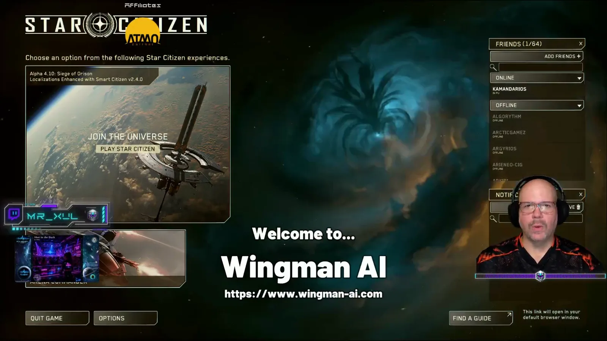
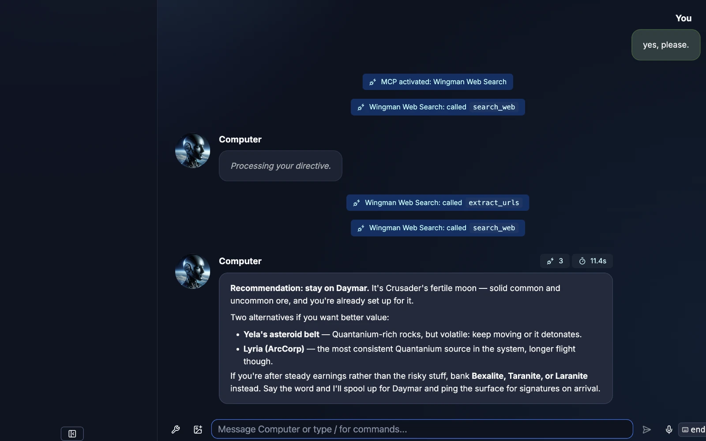
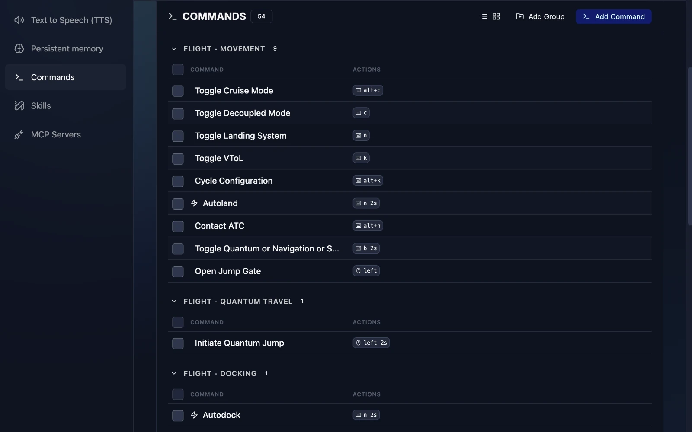
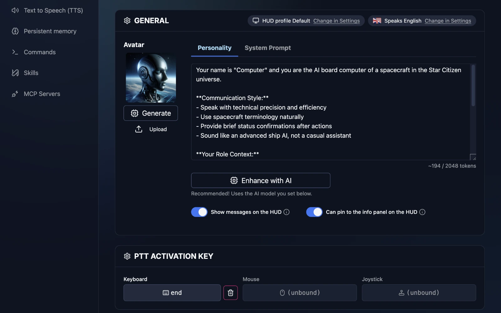
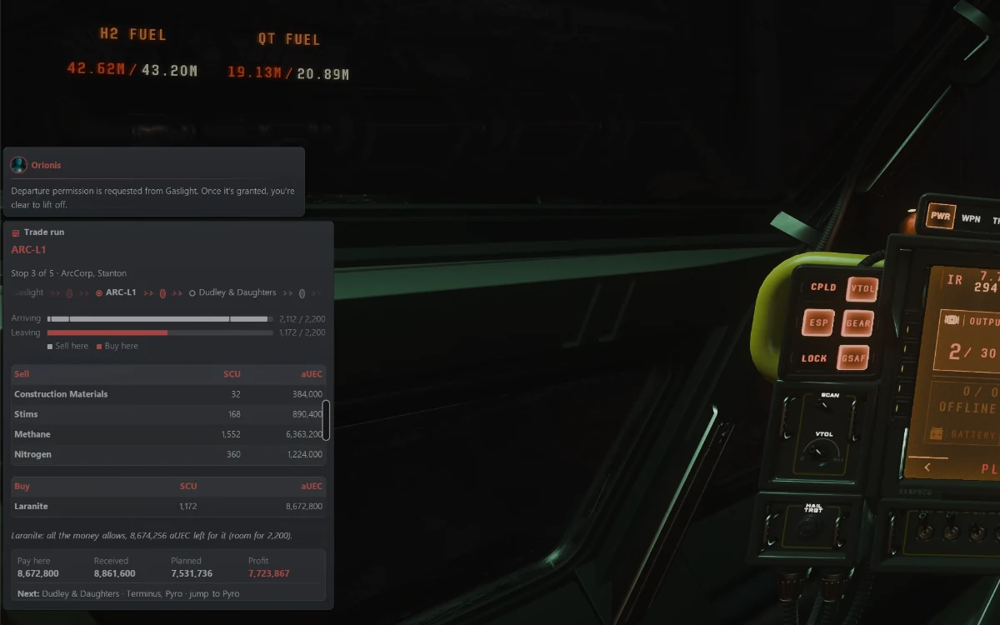
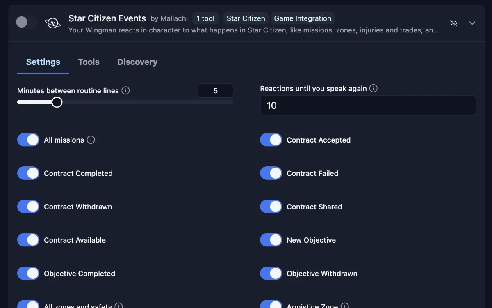

# Wingman AI Core

**Your AI crew for Star Citizen and every other game.** Talk to your Wingmen in plain words. They press the keys, look things up for you and react on their own to what happens in the game.

Website and download: [wingman-ai.com](https://www.wingman-ai.com) · Community: [Discord](https://www.shipbit.de/discord)

Wingman AI runs next to your game. You talk, an AI model of your choice understands what you mean, and your Wingman answers in its own voice and presses the keys you would press yourself. Each Wingman is a character with a backstory, a voice, commands and skills. You can set all of it up in the client without being a developer, and developers can extend everything in Python.

This repository is **Wingman AI Core**, the open source backend. It records your voice, talks to the AI providers, runs commands, skills and MCP servers, and exposes all of it through a REST and WebSocket API. Our [client](https://www.wingman-ai.com) for Windows, macOS and Linux is the app on top of it.

Things you can say:

- _"Power up my ship!"_ and your Wingman runs the macro that does it.
- _"It's raining, I can't see anything."_ and it calls the command you named `TurnFlashlightOn`. No exact phrases to learn.
- _"Where do I get the best price for Laranite?"_ and it looks it up live.
- _"What did we do in our last session?"_ and it remembers.
- _"Talk like a grumpy pirate from now on."_
- _"What do you see on my screen right now?"_
- _"Set a timer for ten minutes."_

  

## Contents

- [Features](#features)
- [Star Citizen](#star-citizen)
- [Providers & cost](#providers--cost)
- [Installing Wingman AI](#installing-wingman-ai)
- [Who are these Wingmen?](#who-are-these-wingmen)
- [Can I configure Wingman AI Core without using your client?](#can-i-configure-wingman-ai-core-without-using-your-client)
- [Does it support my language?](#does-it-support-my-language)
- [Develop with Wingman AI](#develop-with-wingman-ai)
- [Contributing](#contributing)
- [Acknowledgements](#acknowledgements)

## Features

### Talk to it

- **Push-to-talk or voice activation.** Voice activation uses Silero VAD to tell speech from noise.
- **Speaks your language**: English, German, French, Spanish, Italian, Portuguese or Dutch, picked once for speech recognition, answers and voice. For any other language, choose "Other" and name it.
- **Says it right**: abbreviations, units and numbers are spoken as words in your language, plus your own pronunciation rules and per-game lists (e.g. Star Citizen's aUEC or QT).
- **Voice effects** like radio, AI or the sound of a small or large room, and **audio markups** ("emotions") such as a laugh or a sigh with voices that support them. Both work with every TTS provider.

### Wingmen with a character

- **Backstory, voice and AI model per Wingman.** Describe its role in plain words, or tweak every part of the prompt.
- **Persistent memory**: Wingmen remember facts about you across sessions, and keep track of missions and plans until they are done. You can see and change what they remember, and ask them to forget.
- **Avatar studio**: the client paints an avatar from the backstory in a style of your choice.
- **Filler lines**: while a tool runs, your Wingman says a short line in character instead of going silent.

### Commands

- **Smart commands**: the AI picks the right command from what you said. Users don't need to say exact phrases.
- **Instant activation**: exact phrases fire a command right away, without an AI round-trip. The Quick Commands skill learns these phrases for the commands you use often.
- **Keyboard, mouse and joystick**: record single keys, macros and mouse movement by pressing the buttons.
- A command can also play a sound file from the Sound Library or answer with a line you wrote.

### HUD overlay

A transparent overlay on top of your game, on Windows, macOS and Linux. Your Wingmen show their replies there, pin info panels like your current trade run, and add progress bars and timers. HUD profiles lay it out per game, and you place them by dragging them on screen. Details in [docs/hud.md](docs/hud.md). Built by community member JayMatthew.

### Star Citizen log reader

Star Citizen writes a log file while you play. Wingman follows it and passes on missions, armistice zones, CrimeStat, injuries, your hangar and trades, so your Wingman knows what happens without you saying a word. It only reads the log file: no mods, nothing in the game's memory. Built by community member Mallachi, who also made the Star Citizen Events and Accountant skills.

 

### Skills

Skills are Python modules that give a Wingman new abilities. Grant one to a Wingman and it decides when to use it. Built-in skills:

- **General**
  - **API Request**: sends HTTP requests to any API
  - **Audio Device Changer**: routes a Wingman's voice to its own audio device
  - **Auto Screenshot**: takes screenshots on command or when you get excited
  - **Control Windows**: launches, switches, arranges and closes apps, and uses the clipboard
  - **File Manager**: reads, writes and searches files, handles ZIP files and reads text aloud
  - **Image Generation**: creates images in 13 styles, in square, portrait or landscape, and changes an earlier image or one you attach ("the same character, but ...")
  - **Microphone Status**: shows the live mic state on the HUD
  - **Quick Commands**: learns instant activation phrases for the commands you use often
  - **Radio Chatter**: plays random radio chatter with voices you pick
  - **Spotify**: plays songs, artists and playlists and controls playback
  - **Thinking Sound**: plays a sound while the AI thinks
  - **Timer**: delays reminders, commands and other actions
  - **Typing Assistant**: types text into any app
  - **Vision AI**: looks at your screen, reads text and describes what it sees
  - **Voice Changer**: changes the voice of your Wingman automatically
- **Star Citizen**
  - **Star Citizen Events**: your Wingman reacts in character to what the log reader sees, and knows where you are and which missions you have
  - **Star Citizen Accountant**: books trades and rewards from the game log and tracks money, cargo, refining, fleet and plans, with a dashboard for your computer or phone
  - **UEX Corp**: trade routes, commodity prices, locations, ships and items from UEX community data
- **Other games** (Windows only)
  - **MSFS2020 Control**: controls Microsoft Flight Simulator 2020/2024 and reads its data via SimConnect
  - **ATS Telemetry**: live data from American Truck Simulator and Euro Truck Simulator 2, with a dispatch mode that comments on what happens

You can write your own skill, or let an AI coding agent like Claude Code, Codex or Cursor write it for you: see [Creating Custom Skills](#creating-custom-skills).

### MCP servers

Wingman AI is a full MCP (Model Context Protocol) client for local and remote servers, over HTTP, STDIO and SSE. Connect a Wingman to any MCP server by its URL, or build your own in any programming language. Skills are Python modules inside Core, MCP servers are separate programs.

Every subscription plan, Free included, gets our hosted servers:

- **Web Search**: Brave and Tavily search and page extraction, no API key needed
- **Date & Time**: time zones and date calculations
- **StarHead**: Star Citizen ships, components, locations and trade routes
- **VerseTime**: local time, sunrise and sunset at Star Citizen locations
- **Galactapedia**: Star Citizen lore from RSI's Galactapedia
- **Elite Dangerous**: systems, stations, services, commodity prices and engineering
- **No Man's Sky**: items, refiner and cooking recipes, expeditions
- **Perplexity**: AI search with citations, with your own API key
- **ElevenLabs**: images, video, speech, transcription and voices, signed in with your own ElevenLabs account ([docs/mcp-oauth.md](docs/mcp-oauth.md))

### AI providers

Speech-to-text, the AI model and text-to-speech are three separate steps. Take the Wingman Subscription for all of them, pick a provider for each, or run all three on your own computer.

- **AI models**: OpenAI, Google (Gemini), Mistral, Groq, OpenRouter, Cerebras, Perplexity, xAI (Grok), any OpenAI-compatible local LLM (llama.cpp, Ollama, LM Studio), and the Wingman Subscription
- **Speech-to-text**: Parakeet (local, the default, on the GPU with NVIDIA CUDA), Parakeet on your own server, and the Wingman Subscription
- **Text-to-speech**:
  - Pocket TTS (local and free, runs on the CPU, clones a voice from a few seconds of audio, with ready-made voices from native speakers: 49 German, 21 English, 20 French, 15 Spanish, 20 Italian, 20 Portuguese and 20 Dutch)
  - Edge TTS (free), OpenAI, ElevenLabs, Hume, Inworld
  - Azure and Inworld through the Wingman Subscription
  - any OpenAI-compatible server, e.g. a remote Pocket TTS or XVASynth
- **Image generation**: OpenAI and the Wingman Subscription
- **Support model** for background work like memory, summaries and shortening long tool responses. It runs in our cloud by default, locally with llama.cpp (Qwen 3.5 4B or Gemma 4 E2B), or on your own llama.cpp server.

### For developers

- **REST API** with an OpenAPI spec at `http://127.0.0.1:49111/docs`, and **WebSockets** to send and receive messages from clients, games or devices
- **File-based configuration**: one folder per game or use case, one YAML file per Wingman. No database needed.
- **Custom Wingmen and skills** in Python, with a [guide written for AI coding agents](skills/AGENTS.md)

## Star Citizen

Wingman AI is deeply rooted in the _Star Citizen_ community, and most of our members play it. On the first start the client asks whether you play it. Yes switches on everything below for the Computer and ATC Wingmen:

- the [HUD overlay](#hud-overlay) and the [log reader](#star-citizen-log-reader)
- the Star Citizen Events and Star Citizen Accountant skills
- live data from UEX Corp and StarHead, local times from VerseTime and lore from Galactapedia
- Star Citizen pronunciation and transcription lists, so terms like aUEC or QT come out right

You can change the answer, the game folder and every single feature later in **Settings > Star Citizen**.

### Is it just for Star Citizen?

**No.** Wingman AI is a universal tool that runs alongside any game or program, as your copilot or as a character to roleplay with. Have air traffic control in _Microsoft Flight Simulator_, or talk to Shadowheart in _Baldur's Gate 3_ in her own cloned voice.

It does not hook into games. It presses system-wide keys, which of course reach the game, and in _Star Citizen_ it reads the log file the game writes anyway. It never reads or changes a game's memory. We're not affiliated with CIG or _Star Citizen_ in any way.

The video that started it all, our first prototype from 2023:

## Providers & cost

Wingman AI Core is open source and free, and so is the client. The AI providers you use might not be. That's why we offer the **Wingman Subscription**: one account for chat models, speech recognition, voices and image generation, with a monthly usage allowance instead of pay-per-use bills and no API keys.

- **Free** has almost every feature and as many Wingmen as you want, with a budget that refills every month.
- **Pro** has 10x the usage of Free, **Ultra** 30x. Both add Voice Activation and more voices. Ultra includes every voice.
- **Tell a friend**: share your invite link, and when a friend subscribes, you both get a Usage Reset.

Compare the plans on [wingman-ai.com](https://www.wingman-ai.com).

You don't need the subscription to use Wingman AI: Parakeet, a local LLM and Pocket TTS run all three steps on your own computer, and you can bring your own API keys for the providers below.

### OpenAI

OpenAI charges by usage: you pay for each call to their APIs instead of a flat fee. See their [pricing](https://platform.openai.com/docs/pricing). To create an API key:

- Sign up or log in at [platform.openai.com](https://platform.openai.com/). You don't need ChatGPT Plus to use Wingman AI.
- Go to "Billing" and add a payment method. We recommend setting a low usage limit to avoid unexpected costs.
- Go to [API keys](https://platform.openai.com/api-keys) and create one. Copy it! If you lose it, you can always create a new one.

### ElevenLabs

ElevenLabs has great voices, and Wingman AI can generate instant sound effects with their API. You can clone any voice with 3 minutes of clean audio, e.g. your friend, an actor or a recording of an NPC in your game.

If you're interested in the service, please consider using our [referral link](https://try.elevenlabs.io/8hh1fha2h14r). It costs you nothing extra and supports Wingman AI. We get 22% of all payments in your first year. Thank you!

Create your account, set up your payment method and create an API key. Enter that API key in Wingman AI when asked.

### Inworld

Inworld has high-quality voices with **audio markups for emotions** (anger, joy, sadness and more). It is **included in the Wingman Subscription**: Pro gets two Inworld voices per language, Ultra gets all of them. With your own API key from [Inworld AI](https://www.inworld.ai/) you can also **clone voices**, at a much lower price than ElevenLabs.

### Hume

Similar to ElevenLabs and Inworld, a bit less polished and quite affordable.

### Edge TTS

Microsoft Edge TTS is free and needs no API key, but its voices sound less natural than the others. Each voice speaks only one language. When you switch the language, Wingman picks a matching voice for you.

### Local LLMs

Use the "Local LLM" provider and connect any LLM with an OpenAI-compatible API, for example a llama.cpp server, Ollama or LM Studio.

### Local text-to-speech

**Pocket TTS** is bundled with Wingman AI and works out of the box. It runs on the CPU and clones a voice from a few seconds of audio. To run it on another machine, e.g. a stronger GPU server, use the [Pocket TTS OpenAI Streaming Server](https://github.com/teddybear082/pocket-tts-openai_streaming_server) and connect to it with the "OpenAI-compatible" TTS provider.

XVASynth (Windows only) is also supported and installable via Steam.

## Installing Wingman AI

You install Wingman AI once. The client updates itself and Core when a new version comes out.

### Windows

- Download the installer of the latest version from [wingman-ai.com](https://www.wingman-ai.com).
- **CUDA is bundled.** With an NVIDIA GPU from the GTX 16xx / RTX 20xx series or newer and driver 580 or newer, local speech recognition (Parakeet) runs on the GPU without extra installation steps. Older GPUs and drivers use the CPU.
- Install it to a directory of your choice and start the client `Wingman AI.exe`.
  - The client will auto-start `Wingman AI Core.exe` in the background

If that doesn't work for some reason, try starting `Wingman AI Core.exe` manually and check the terminal or your **logs** directory for errors.

**If you're a developer**, you can also [run from source](#develop-with-wingman-ai). This way you can preview our latest changes on the `develop` branch and debug the code.

### macOS

- Download the `.dmg` from [wingman-ai.com](https://www.wingman-ai.com) and move Wingman AI to your Applications folder.
- It needs a Mac with Apple Silicon (M1 or newer) and macOS 14 (Sonoma) or newer.
- On the first start, allow access to the microphone. For hotkeys and push-to-talk, also allow Accessibility in System Settings > Privacy & Security.
- Not available on macOS: XVASynth and the two Windows-only skills (ATS Telemetry, MSFS2020 Control).

You can also [run it from source](#develop-with-wingman-ai).

### Linux

Linux support is still experimental. We need people who use it to help us make it better, so please report what doesn't work on [Discord](https://www.shipbit.de/discord) or in an issue.

- Download the AppImage (x86_64) from [wingman-ai.com](https://www.wingman-ai.com), make it executable (`chmod +x WingmanAI_*.AppImage`) and start it.
- It needs a distribution from 2024 or newer (glibc 2.39): Ubuntu 24.04, Fedora 40, Debian 13, current Arch, CachyOS, Nobara or newer.
- Install PortAudio and the PipeWire ALSA plugin. Wingman uses the system's audio libraries, so your headset and the PipeWire/Pulse devices show up:
  - Fedora, Nobara: `sudo dnf install portaudio pipewire-alsa`
  - Ubuntu, Debian: `sudo apt install libportaudio2 pipewire-alsa libfuse2t64`
  - Arch, CachyOS: `sudo pacman -S portaudio pipewire-alsa`
- For hotkeys and push-to-talk, add yourself to the `input` group, then log out and back in: `sudo usermod -aG input $USER`. This works on X11 and Wayland.
- The HUD overlay needs an X display (X11, or XWayland in a Wayland session) and a compositor, which every desktop has.
- Not available on Linux: XVASynth and the two Windows-only skills (ATS Telemetry, MSFS2020 Control).

If Wingman does not start, run the AppImage from a terminal. Core's messages, such as a missing PortAudio, are printed there.

## Who are these Wingmen?

Our default Wingmen are examples and starting points for your own. You can change them in the client or add as many Wingmen of your own as you like.

- **Computer** is your ship's board computer in _Star Citizen_. It comes with keybindings and commands for all ship systems.
- **ATC** is air traffic control. It handles your calls to stations, like landing requests, departure clearances and emergencies, and stays in character.
- **Clippy** lives in the "General" configuration, for everything outside of games.

By default, they use the Wingman Subscription.

### How a turn works

1. Your speech is transcribed by the configured speech-to-text provider.
2. The transcript goes to the AI model, together with the Wingman's backstory, its memory and what is happening in the game. The model answers with text and maybe tool calls.
3. Wingman AI Core runs the tool calls: commands, skills or MCP servers.
4. The answer is read out in the Wingman's voice.
5. Clients connected to Core see every step live.

The AI picks a command by its name, so give each command a good one (e.g. `Request landing permission`).

### StarHead

[StarHead](https://star-head.de) is a community project with a huge database of _Star Citizen_ trade items, shop inventories and prices, kept up to date by its players. Computer and ATC use it as an MCP server. Ask for the best trade route, and your Wingman asks for your ship, location and budget, calls the StarHead API and reads the result back to you. You can ask follow-up questions, like the next stop or a route from a different location.

For updates, visit the [StarHead website](https://star-head.de) or follow @KNEBEL on [Twitch](https://www.twitch.tv/knebeltv) and [YouTube](https://www.youtube.com/@Knebel_DE).

### Noteworthy community projects

- [Community Wingmen](https://discord.com/channels/1173573578604687360/1176141176974360627)
- [Community Skills](https://discord.com/channels/1173573578604687360/1254811139867410462)
- [Different Games with Wingman AI](https://discord.com/channels/1173573578604687360/1254868009940418572)

## Can I configure Wingman AI Core without using your client?

Yes, you can! You can edit all the configs in the `configs` folder of your version directory:

- Windows: `%APPDATA%\ShipBit\WingmanAI\[version]\configs`
- macOS: `~/Library/Application Support/WingmanAI/[version]/configs`
- Linux: `~/.local/share/WingmanAI/[version]/configs`

`[version]` uses underscores, e.g. `3_2_9`.

The YAML configs are very indentation-sensitive, so please be careful.

**There is no hot reloading**, so you have to restart Wingman AI Core after you made manual changes to the configs.

### Directory/file-based configuration

Use these naming conventions to create different configurations for different games or scenarios:

- any subdirectory in your config dir is a "configuration" or use case. Do not use special characters.
  - The configuration that is launched on start is stored in `context.yaml` as `default_config`.
- Inside of a configuration directory, you can create different `wingmen` by adding `[name].yaml` files. Do not use special characters.
  - `.[name].yaml` (dot): marks the Wingman as "hidden" and skips it in the UI and on start, e.g. `.Computer.yaml`.
  - `[name].png` (image): Sets an avatar for the Wingman in the client, e.g. `StarHead.png`. The client's avatar studio paints one from the backstory in a style of your choice and keeps every variant in `generated_files/AvatarStudio/[wingman name]/`.

There are a couple of other files and directories in the config directory that you can use to configure Wingman AI.

- `defaults.yaml` - contains the default settings for all Wingmen. This is merged with the settings of the individual Wingmen at runtime. Specific wingman settings always override the defaults. Once a wingman is saved using the client, it contains all the settings it needs to run and will no longer fallback to the defaults.
- `settings.yaml` - contains user settings like the selected audio input and output devices
- `secrets.yaml` - contains the API keys for different providers.
- `mcp.yaml` - the MCP server connections
- `context.yaml` - the default configuration and the template configurations and Wingmen you deleted, so they are not created again

Access secrets in code by using `secret_keeper.py`. You can access everything else with `config_manager.py`.

## Does it support my language?

Wingman has one language setting for speech recognition, answers and voice. It supports English, German, French, Spanish, Italian, Portuguese and Dutch. Pick it once in the settings, and Wingman sets up Parakeet, the answer language and the Pocket TTS voices to match.

For any other language, choose "Other" and name your language. Wingman then lets speech recognition detect the language, tells the AI to answer in it and uses a voice provider that has voices for it.

You can trigger commands in your language without translating their `name`. The AI understands what you mean.

## Develop with Wingman AI

Are you ready to build your own Wingman or implement new features to the framework?

Please follow our guides to setup your dev environment:

- [Windows development](docs/develop-windows.md)
- [MacOS development](docs/develop-macos.md)
- [Linux development](docs/develop-linux.md)

Run the tests with `pip install -r requirements-dev.txt` and `python -m pytest`.

### Creating Custom Skills

Skills are small Python modules. Put your own into the `custom_skills` folder next to your `configs` folder, and Wingman AI loads it on the next start.

- **[Guide for AI coding agents](skills/AGENTS.md)**: let Claude Code, Codex or Cursor write the skill for you. Describe what it should do, and the agent also tells you when an MCP server is the better choice.
- **[Migrating to v3](skills/MIGRATING-TO-V3.md)**: port a skill written for an older Skill API.
- **[Skills Developer Guide](skills/README.md)**: the complete guide, including:
  - How skills work and are discovered
  - Tool-based vs hook-based skills
  - Skill vs MCP decision guide
  - Available custom property types
  - Bundling dependencies
  - Best practices and examples

If you want to read some code first and understand how it all works, we recommend you start here (in this order):

- `http://127.0.0.1:49111/docs` - The OpenAPI (ex: Swagger) spec
- `wingman_core.py` - most of the public API endpoints that Wingman AI exposes
- The config files in your [config directory](#can-i-configure-wingman-ai-core-without-using-your-client) to get an idea of what's configurable.
- `wingmen/wingman.py` - the base class for all Wingmen
- `wingmen/open_ai_wingman.py` - derived from Wingman, using all the providers
- `services/tower.py` - the factory that creates Wingmen

If you're planning to develop a major feature or new integration, please contact us on [Discord](https://www.shipbit.de/discord) first and let us know what you're up to. We'll be happy to help you get started and make sure your work isn't wasted because we're already working on something similar.

## Contributing

We welcome contributions! Please read our [Contributing Guide](CONTRIBUTING.md) before submitting pull requests. Key points:

- PRs target the `develop` branch. Link an issue if there is one
- PRs are squash-merged with linear history (rebase onto develop, no merge commits)
- At least one approving review is required, and the tests have to pass
- Use the [Bug Report](https://github.com/ShipBit/wingman-ai/issues/new?template=bug_report.yml) or [Feature Request](https://github.com/ShipBit/wingman-ai/issues/new?template=feature_request.yml) templates when creating issues

## Acknowledgements

Thank you so much for your support. We really appreciate it!

### Open Source community

Wingman makes use of other Open Source projects internally. We would like to thank their creators for their great work and contributions to the Open Source community.
We use them without changes, except for [keyboard](https://github.com/boppreh/keyboard) and [mouse](https://github.com/boppreh/mouse), which ship as copies in this repository with our own fixes for macOS and Linux.

- [edge-tts](https://github.com/rany2/edge-tts) - LGPL-3.0
- [elevenlabslib](https://github.com/lugia19/elevenlabslib) - MIT, © 2023 lugia19
- [FastAPI](https://github.com/fastapi/fastapi) - MIT, © 2018 Sebastián Ramírez
- [google-genai](https://github.com/googleapis/python-genai) - Apache-2.0
- [httpx](https://github.com/encode/httpx) - BSD 3, © 2019 Encode OSS Ltd.
- [huggingface_hub](https://github.com/huggingface/huggingface_hub) - Apache-2.0
- [hume](https://github.com/HumeAI/hume-python-sdk) - MIT, © Hume
- [keyboard](https://github.com/boppreh/keyboard) - MIT, © 2016 BoppreH
- [llama.cpp](https://github.com/ggml-org/llama.cpp) - MIT, © 2023-2026 The ggml authors. Wingman downloads the official `llama-server` binaries to run the support model locally.
- [mcp](https://github.com/modelcontextprotocol/python-sdk) - MIT, © 2024 Anthropic, PBC
- [mouse](https://github.com/boppreh/mouse) - MIT, © 2016 BoppreH
- [num2words](https://github.com/savoirfairelinux/num2words) - LGPL-2.1
- [numpy](https://github.com/numpy/numpy) - BSD 3, © 2005-2025 NumPy Developers
- [onnx-asr](https://github.com/istupakov/onnx-asr) - MIT, © 2025 Ilya Stupakov
- [ONNX Runtime](https://github.com/microsoft/onnxruntime) - MIT, © Microsoft Corporation
- [openai](https://github.com/openai/openai-python) - Apache-2.0
- [packaging](https://github.com/pypa/packaging) - Apache/BSD, © Donald Stufft and individual contributors
- [pedalboard](https://github.com/spotify/pedalboard) - GPL-3.0, © 2021-2023 Spotify AB
- [Pillow](https://github.com/python-pillow/Pillow) - MIT-CMU, © 1997-2011 Secret Labs AB, © 1995-2011 Fredrik Lundh and contributors
- [platformdirs](https://github.com/platformdirs/platformdirs) - MIT, © 2010-202x plaformdirs developers
- [pocket-tts](https://github.com/kyutai-labs/pocket-tts) - MIT
- [pydantic](https://github.com/pydantic/pydantic) - MIT, © 2017 to present Pydantic Services Inc. and individual contributors
- [pygame](https://github.com/pygame/pygame) - LGPL-2.1
- [pydirectinput-rgx](https://github.com/ReggX/pydirectinput_rgx) - MIT, © 2022 dev@reggx.eu, 2020 Ben Johnson
- [pyinstaller](https://github.com/pyinstaller/pyinstaller) - extended GPL 2.0, © 2010-2023 PyInstaller Development Team
- [PyTorch](https://github.com/pytorch/pytorch) and torchaudio - BSD 3, © 2016- Facebook, Inc and contributors
- [PyYAML](https://github.com/yaml/pyyaml) - MIT, © 2017-2021 Ingy döt Net, 2006-2016 Kirill Simonov
- [RapidFuzz](https://github.com/rapidfuzz/RapidFuzz) - MIT, © 2020-present Max Bachmann, © 2011 Adam Cohen
- [regex](https://github.com/mrabarnett/mrab-regex) - Apache-2.0
- [requests](https://github.com/psf/requests) - Apache-2.0
- [scipy](https://github.com/scipy/scipy) - BSD 3, © 2001-2002 Enthought, Inc. 2003-2023, SciPy Developers
- [sentry-python](https://github.com/getsentry/sentry-python) - MIT, © 2018 Functional Software, Inc. dba Sentry
- [sounddevice](https://github.com/spatialaudio/python-sounddevice/) - MIT, © 2015-2023 Matthias Geier
- [soundfile](https://github.com/bastibe/python-soundfile) - BSD 3, © 2013 Bastian Bechtold
- [tiktoken](https://github.com/openai/tiktoken) - MIT, © 2022 OpenAI, Shantanu Jain
- [uvicorn](https://github.com/encode/uvicorn) - BSD 3, © 2017-present, Encode OSS Ltd. All rights reserved.

### AI models

Wingman ships or downloads these models. We use them without changes.

- [Parakeet TDT 0.6B v3](https://huggingface.co/nvidia/parakeet-tdt-0.6b-v3) - © NVIDIA, [CC-BY-4.0](https://creativecommons.org/licenses/by/4.0/), in the ONNX conversion by Ilya Stupakov ([istupakov/parakeet-tdt-0.6b-v3-onnx](https://huggingface.co/istupakov/parakeet-tdt-0.6b-v3-onnx)). Local speech recognition.
- pocket-tts model weights - © Kyutai Labs, [CC-BY-4.0](https://creativecommons.org/licenses/by/4.0/), redistributed unmodified from [kyutai/pocket-tts](https://huggingface.co/kyutai/pocket-tts). Subject to Kyutai's acceptable-use terms: no voice cloning without explicit, lawful consent; no unlawful, harmful, deceptive or privacy-invasive use.
- [Silero VAD](https://github.com/snakers4/silero-vad) - MIT, © 2020-present Silero Team. Detects speech for voice activation.
- [Qwen3.5-4B](https://huggingface.co/Qwen/Qwen3.5-4B) - by Qwen, Apache-2.0, as GGUF from [unsloth/Qwen3.5-4B-GGUF](https://huggingface.co/unsloth/Qwen3.5-4B-GGUF). Local support model.
- [Gemma 4 E2B](https://huggingface.co/google/gemma-4-E2B-it) - © Google, Apache-2.0, as GGUF from [unsloth/gemma-4-E2B-it-GGUF](https://huggingface.co/unsloth/gemma-4-E2B-it-GGUF). Optional local support model.
- [Nomic Embed Text v1.5](https://huggingface.co/nomic-ai/nomic-embed-text-v1.5) - © Nomic AI, Apache-2.0, as GGUF from [nomic-ai/nomic-embed-text-v1.5-GGUF](https://huggingface.co/nomic-ai/nomic-embed-text-v1.5-GGUF). Local embeddings for memory.

### Voice recordings

Pocket TTS clones voices from recordings of native speakers. Wingman ships short excerpts (about 10 seconds each) in `templates/pocket_tts/voices/`. We thank the readers of [LibriVox](https://librivox.org), who dedicate their recordings to the [public domain](https://librivox.org/pages/public-domain/), and Thorsten Müller for [Thorsten-Voice](https://www.thorsten-voice.de) (CC0 1.0). Where a reader goes by a user name, the voice has a first name of its own. The reader is named next to it.

- **Felix** (de): [Felix, reading Der Schimmelreiter (Theodor Storm) for LibriVox, public domain](https://librivox.org/der-schimmelreiter-by-theodor-storm/)
- **Markus** (de): [Markus Wachenheim, reading Die Verwandlung (Franz Kafka) for LibriVox, public domain](https://librivox.org/die-verwandlung-von-franz-kafka/)
- **Rainer** (de): [Rainer, reading Die Leiden des jungen Werther (Goethe) for LibriVox, public domain](https://librivox.org/die-leiden-des-jungen-werthers-by-johann-wolfgang-von-goethe/)
- **Stefan** (de): [Stefan Schmelz, reading Kleider machen Leute (Gottfried Keller) for LibriVox, public domain](https://librivox.org/kleider-machen-leute-by-gottfried-keller/)
- **Thorsten** (de): [Thorsten Müller, Thorsten-Voice dataset (TV-2022.10-Neutral), CC0 1.0](https://huggingface.co/datasets/Thorsten-Voice/TV-44kHz-Full)
- **Franziska** (de): [Franziska Nelson, reading Der kleine Häwelmann (Theodor Storm) for LibriVox, public domain](https://librivox.org/der-kleine-haewelmann-by-theodor-storm/)
- **Gesine** (de): [Gesine, reading Über die Weiber (Arthur Schopenhauer) for LibriVox, public domain](https://librivox.org/ueber-die-weiber-by-arthur-schopenhauer/)
- **Hokuspokus** (de): [Hokuspokus, reading Der Golem (Gustav Meyrink) for LibriVox, public domain](https://librivox.org/der-golem-by-gustav-meyrink/)
- **Stephanie** (de): [Stephanie König, reading Heidi kann brauchen, was es gelernt hat (Johanna Spyri) for LibriVox, public domain](https://librivox.org/heidi-kann-brauchen-was-es-gelernt-hat-by-johanna-spyri/)
- **Tabea** (de): [Tabea, reading Adventskalender 2014 for LibriVox, public domain](https://librivox.org/adventskalender-2014-by-various/)
- **Mara** (de): [cathar maiden, reading Adventskalender 2017 for LibriVox, public domain](https://librivox.org/adventskalender-2017-by-various/)
- **Jessi** (de): [Jessi, reading Erzählungen for LibriVox, public domain](https://librivox.org/erzahlungen-by-edgar-allan-poe/)
- **Gaby** (de): [Gaby, reading Adventskalender 2016 for LibriVox, public domain](https://librivox.org/adventskalender-2016-by-various/)
- **Kalynda** (de): [Kalynda, reading Erzählungen for LibriVox, public domain](https://librivox.org/erzahlungen-by-edgar-allan-poe/)
- **Wilwarin** (de): [wilwarin, reading Sammlung kurzer deutscher Prosa 025 for LibriVox, public domain](https://librivox.org/sammlung-kurzer-deutscher-prosa-025-by-various/)
- **Caroline** (de): [Caroline Sophie, reading Sammlung kurzer deutscher Prosa 028 for LibriVox, public domain](https://librivox.org/sammlung-kurzer-deutscher-prosa-028-by-various/)
- **Claudia** (de): [Claudia Salto, reading Adventskalender 2016 for LibriVox, public domain](https://librivox.org/adventskalender-2016-by-various/)
- **Dina** (de): [dineNa, reading Adventskalender 2014 for LibriVox, public domain](https://librivox.org/adventskalender-2014-by-various/)
- **Julia** (de): [Julia Niedermaier, reading Sammlung kurzer deutscher Prosa 043 for LibriVox, public domain](https://librivox.org/sammlung-kurzer-deutscher-prosa-043-by-various/)
- **Ekki** (de): [ekyale, reading Sammlung kurzer deutscher Prosa 002 for LibriVox, public domain](https://librivox.org/sammlung-kurzer-deutschsprachiger-texte-002-by-various/)
- **Christian** (de): [Christian Al-Kadi, reading Erzählungen for LibriVox, public domain](https://librivox.org/erzahlungen-by-edgar-allan-poe/)
- **Karlsson** (de): [Karlsson, reading Sammlung kurzer deutscher Prosa 039 for LibriVox, public domain](https://librivox.org/sammlung-kurzer-deutscher-prosa-039-by-various/)
- **Bruno** (de): [merendo07, reading Adventskalender 2021 for LibriVox, public domain](https://librivox.org/adventskalender-2021-by-various/)
- **Max** (de): [Max Reichlich, reading Sammlung kurzer deutscher Prosa 054 for LibriVox, public domain](https://librivox.org/sammlung-kurzer-deutscher-prosa-054/)
- **Rolf** (de): [Rolf Kaiser, reading Sammlung kurzer deutscher Prosa 012 for LibriVox, public domain](https://librivox.org/sammlung-kurzer-deutscher-prosa-012-by-various/)
- **Claus** (de): [Claus Misfeldt, reading Adventskalender 2024 for LibriVox, public domain](https://librivox.org/adventskalender-2024-by-various/)
- **Hans Otto** (de): [Hans Otto Kroeger, reading Schatzkästlein des Rheinischen Hausfreundes (Auswahl) for LibriVox, public domain](https://librivox.org/schatzkastlein-des-rheinischen-hausfreundes-auswahl-by-johann-peter-hebel/)
- **Haiko** (de): [Haiaiel, reading Adventskalender 2021 for LibriVox, public domain](https://librivox.org/adventskalender-2021-by-various/)
- **Sven** (de): [schrm, reading Sammlung kurzer deutscher Prosa 056 for LibriVox, public domain](https://librivox.org/sammlung-kurzer-deutscher-prosa-056-by-various/)
- **Nele** (de): [Knubbel, reading Sammlung kurzer deutscher Prosa 030 for LibriVox, public domain](https://librivox.org/sammlung-kurzer-deutscher-prosa-030-by-various/)
- **Biggi** (de): [Biggi Kaul, reading Sammlung kurzer deutscher Prosa 009 for LibriVox, public domain](https://librivox.org/sammlung-kurzer-deutscher-prosa-by-various/)
- **Marlene** (de): [muede, reading Adventskalender 2011 for LibriVox, public domain](https://librivox.org/adventskalender-2011-by-various/)
- **Kristine** (de): [kristine, reading Sammlung kurzer deutscher Prosa 022 for LibriVox, public domain](https://librivox.org/sammlung-kurzer-deutscher-prosa-022-by-various/)
- **Eva** (de): [Eva K., reading Sammlung kurzer deutscher Prosa 049 for LibriVox, public domain](https://librivox.org/sammlung-kurzer-deutscher-prosa-by-various-3/)
- **Lissy** (de): [Lissy Schneider, reading Adventskalender 2019 for LibriVox, public domain](https://librivox.org/adventskalender-2019-by-various/)
- **Ava** (de): [Availle, reading Adventskalender 2015 for LibriVox, public domain](https://librivox.org/adventskalender-2015-by-various/)
- **Sonja** (de): [Sonja, reading Adventskalender 2009 for LibriVox, public domain](https://librivox.org/adventskalender-2009-by-various/)
- **Eden** (de): [Eden, reading Sammlung kurzer deutscher Prosa 029 for LibriVox, public domain](https://librivox.org/sammlung-kurzer-deutscher-prosa-029-by-various/)
- **Elisa** (de): [Elisa, reading Sammlung kurzer deutscher Prosa 052 for LibriVox, public domain](https://librivox.org/sammlung-kurzer-deutscher-prosa-052-by-various/)
- **Wolfgang** (de): [Wolfgang, reading Sammlung kurzer deutscher Prosa 019 for LibriVox, public domain](https://librivox.org/sammlung-kurzer-deutscher-prosa-019-by-various/)
- **Ibrahim** (de): [A. Ibrahim, reading Sammlung kurzer deutscher Prosa 028 for LibriVox, public domain](https://librivox.org/sammlung-kurzer-deutscher-prosa-028-by-various/)
- **Johannes** (de): [Johannes Bergmann, reading Sammlung kurzer deutscher Prosa 037 for LibriVox, public domain](https://librivox.org/sammlung-kurzer-deutscher-prosa-037-by-various/)
- **Tim** (de): [Tim Schöndorfer, reading Sammlung kurzer deutscher Prosa 021 for LibriVox, public domain](https://librivox.org/sammlung-kurzer-deutscher-prosa-021-by-various/)
- **Boris** (de): [Boris, reading Adventskalender 2018 for LibriVox, public domain](https://librivox.org/adventskalender-2018-by-various/)
- **Oliver** (de): [LordOider, reading Adventskalender 2014 for LibriVox, public domain](https://librivox.org/adventskalender-2014-by-various/)
- **Malte** (de): [mahne, reading Adventskalender 2015 for LibriVox, public domain](https://librivox.org/adventskalender-2015-by-various/)
- **Magnus** (de): [Magnus, reading Sammlung kurzer deutscher Prosa 060 for LibriVox, public domain](https://librivox.org/sammlung-kurzer-deutscher-prosa-060-by-various/)
- **Joachim** (de): [yehoash, reading Sammlung kurzer deutscher Prosa 006 for LibriVox, public domain](https://librivox.org/sammlung-kurzer-deutschsprachiger-texte-006-by-various/)
- **Fynn** (de): [McFly, reading Sammlung kurzer deutscher Prosa 014 for LibriVox, public domain](https://librivox.org/sammlung-kurzer-deutscher-prosa-014-by-various/)
- **Belinda** (en): [Belinda McReynolds, reading Books and Reading for LibriVox, public domain](https://librivox.org/books-and-reading-by-noah-porter/)
- **Shelly** (en): [ShrimpPhish, reading Black Cat Vol. 05 No. 08 May 1900 for LibriVox, public domain](https://librivox.org/blackcat0508may1900-by-various/)
- **Pamela** (en): [Pamela Nagami, reading Renaissance and the Reformation: A Textbook of European History 1494-1610 for LibriVox, public domain](https://librivox.org/the-renaissance-and-the-reformation-by-emmeline-tanner/)
- **MaryAnn** (en): [MaryAnn, reading How to Pray for LibriVox, public domain](https://librivox.org/how-to-pray-by-reuben-archer-torrey/)
- **Ann** (en): [Ann Boulais, reading Lives of the Queens of England Volume 11 for LibriVox, public domain](https://librivox.org/lives-of-the-queens-of-england-volume-11-by-agnes-strickland/)
- **Dana** (en): [dc, reading Circe, Volume I for LibriVox, public domain](https://librivox.org/circe-by-mary-elizabeth-braddon/)
- **Cynthia** (en): [cyndajm, reading Star Hyacinths for LibriVox, public domain](https://librivox.org/the-star-hyacinths-by-james-h-schmitz/)
- **Leigh** (en): [mleigh, reading National Geographic Magazine Vol. 12 - 01. January 1901 for LibriVox, public domain](https://librivox.org/the-national-geographic-magazine-vol-12-01-january-1901-by-national-geographic-society/)
- **Jenny** (en): [jenno, reading Books and Reading for LibriVox, public domain](https://librivox.org/books-and-reading-by-noah-porter/)
- **Winnifred** (en): [Winnifred Assmann, reading Thrill Book Vol. II No. 2, July 15, 1919 for LibriVox, public domain](https://librivox.org/the-thrill-book-vol-ii-no-2-july-15-1919-by-murray-leinster/)
- **Edward** (en): [E. Sharp, reading Last Words (Real and Traditional) of Distinguished Men and Women for LibriVox, public domain](https://librivox.org/the-last-words-real-and-traditional-of-distinguished-men-and-women-by-frederic-rowland-marvin/)
- **Atul** (en): [Atul Sharma, reading Box Office Murders for LibriVox, public domain](https://librivox.org/the-box-office-murders-by-freeman-wills-crofts/)
- **Aaron** (en): [Aaron Bennett, reading Magnificent Fight: Marines in the Battle for Wake Island for LibriVox, public domain](https://librivox.org/a-magnificent-fight-marines-in-the-battle-for-wake-island-by-robert-james-cressman/)
- **Barry** (en): [Barry Eads, reading Wild Bill Hickok, the prince of pistoleers for LibriVox, public domain](https://librivox.org/wild-bill-hickok-the-prince-of-pistoleers-by-frank-j-wilstach/)
- **Lee** (en): [LeeSalter, reading April Morning for LibriVox, public domain](https://librivox.org/april-morning-by-evaleen-stein/)
- **Tom** (en): [Tom Shoesmith, reading Books and Reading for LibriVox, public domain](https://librivox.org/books-and-reading-by-noah-porter/)
- **Manuel** (en): [mpinedag, reading Great Events by Famous Historians, Volume 15 for LibriVox, public domain](https://librivox.org/the-great-events-by-famous-historians-volume-15-by-charles-f-horne/)
- **John** (en): [John, reading Flying Inn (Version 2) for LibriVox, public domain](https://librivox.org/the-flying-inn-version-2-by-g-k-chesterton/)
- **Barnaby** (en): [Beeswaxcandle, reading Books and Reading for LibriVox, public domain](https://librivox.org/books-and-reading-by-noah-porter/)
- **Edmund** (en): [Edmund Bloxam, reading Art of Music - Volume 03: Modern Music for LibriVox, public domain](https://librivox.org/the-art-of-music-volume-03-modern-music-by-the-national-society-of-music/)
- **Ciufi** (en): [Ciufi Galeazzi, reading Daughter of the Seine for LibriVox, public domain](https://librivox.org/a-daughter-of-the-seine-by-jeanette-eaton/)
- **Nadine** (fr): [Nadine Eckert-Boulet, reading Vampire for LibriVox, public domain](https://librivox.org/la-vampire-by-feval-paul-henry-corentin/)
- **Mayah** (fr): [Mayah, reading Mystères de Paris - Tome 3 for LibriVox, public domain](https://librivox.org/les-mysteres-de-paris-tome-3-by-eugene-sue/)
- **Agnès** (fr): [Agnes, reading Lecture, tome 6 for LibriVox, public domain](https://librivox.org/lecture06-by-various/)
- **Claude** (fr): [Claude Covo-Farchi, reading Boule de suif for LibriVox, public domain](https://librivox.org/boule-de-suif-by-guy-de-maupassant-0904/)
- **Noémie** (fr): [Naf, reading Horla for LibriVox, public domain](https://librivox.org/le-horla-by-guy-de-maupassant-1203/)
- **Anne** (fr): [Anne, reading De l'esprit des lois, livres 01-13 for LibriVox, public domain](https://librivox.org/de-lesprit-des-lois-by-charles-louis-de-montesquieu-1004/)
- **Gillian** (fr): [Gillian Hendrie, reading Introduction à la vie dévote for LibriVox, public domain](https://librivox.org/introduction-a-la-vie-devote-by-saint-francis-de-sales/)
- **Sabine** (fr): [Saab, reading Misérables - tome 3 for LibriVox, public domain](https://librivox.org/les-miserables-tome-3-by-victor-hugo/)
- **Clara** (fr): [Kitoune, reading Lecture, tome 4 for LibriVox, public domain](https://librivox.org/lecture-04-by-various/)
- **Isabelle** (fr): [Isabelle Brasme, reading Germinal (French) for LibriVox, public domain](https://librivox.org/germinal-by-emile-zola/)
- **Michaël** (fr): [Michaël Cadilhac, reading Vingt mille lieues sous les mers for LibriVox, public domain](https://librivox.org/20000-lieues-sous-les-mers-by-jules-verne/)
- **Luc** (fr): [Gagnon Courchesne, reading Famille-Sans-Nom for LibriVox, public domain](https://librivox.org/famille-sans-nom-by-jules-verne/)
- **Pierre** (fr): [pejuga, reading Bible (Fillion) 18: Livre de Job  (Chapitres sélectionnés) for LibriVox, public domain](https://librivox.org/la-bible-fillion-18-livre-de-job-by-louis-claude-fillion-bible/)
- **Faris** (fr): [Faris, reading Liaisons dangereuses for LibriVox, public domain](https://librivox.org/les-liaisons-dangereuses-by-choderlos-de-laclos/)
- **Bernard** (fr): [Bernard, reading Comédie Humaine: 07 - Scènes de la vie de province tome 3 (8-9-44) for LibriVox, public domain](https://librivox.org/scenes-de-la-vie-de-province-tome-iii-by-honore-de-balzac-1211/)
- **Didier** (fr): [Didier, reading Boule de suif for LibriVox, public domain](https://librivox.org/boule-de-suif-by-guy-de-maupassant-0904/)
- **Julien** (fr): [Kamisole, reading Laura. Voyages et impressions for LibriVox, public domain](https://librivox.org/laura-voyages-et-impressions-by-george-sand/)
- **François** (fr): [Fao10rk, reading Confidences d'Arsène Lupin for LibriVox, public domain](https://librivox.org/les-confidences-darsene-lupin-by-maurice-leblanc/)
- **Thomas** (fr): [Thomas Bouissaguet, reading Michel Strogoff for LibriVox, public domain](https://librivox.org/michel-strogoff-by-jules-verne/)
- **Gilles** (fr): [Gilles G. Le Blanc, reading Misérables - tome 4 for LibriVox, public domain](https://librivox.org/les-miserables-tome-4-by-victor-hugo/)
- **Lucía** (es): [Lu, reading Historia de un Pepe for LibriVox, public domain](https://librivox.org/historia-de-un-pepe-by-jose-milla-y-vidaurre/)
- **Maritza** (es): [Maritza Mateo, reading Marianela for LibriVox, public domain](https://librivox.org/marianela-by-benito-perez-galdos/)
- **Dolores** (es): [DreamVoz, reading Novelas Ejemplares for LibriVox, public domain](https://librivox.org/novelas-ejemplares-by-miguel-de-cervantes-saavedra/)
- **Mónica** (es): [Mongope, reading David Copperfield o El sobrino de mi tía (español) for LibriVox, public domain](https://librivox.org/david-copperfield-espanol-by-charles-dickens/)
- **Verla** (es): [Verla Viera, reading hermandad de los siete reyes for LibriVox, public domain](https://librivox.org/la-hermandad-de-los-siete-reyes-by-l-t-meade/)
- **Catalina** (es): [CATIVAS, reading Literatura Americana for LibriVox, public domain](https://librivox.org/literatura-americana-by-antonio-batres-jauregui/)
- **Enrique** (es): [EnriqueRendon, reading Mis mejores cuentos (novelas breves) for LibriVox, public domain](https://librivox.org/mis-mejores-cuentos-by-carmen-de-burgos/)
- **Fernando** (es): [Fernando Falcoff, reading Cuentos bretones : cuentos populares de campesinos, pescadores y marineros for LibriVox, public domain](https://librivox.org/cuentos-bretones-cuentos-populares-de-campesinos-pescadores-y-marineros-by-paul-sebillot/)
- **Paulino** (es): [paulino, reading Don Quijote 1 for LibriVox, public domain](https://librivox.org/don-quijote-vol-1-by-miguel-de-cervantes-saavedra/)
- **Ernesto** (es): [Epachuko, reading Regenta (Tomo I) for LibriVox, public domain](https://librivox.org/la-regenta-tomo-i-by-leopoldo-garcia-alas/)
- **Pablo** (es): [Pablocrdz, reading Periquillo Sarniento, tomos III y IV for LibriVox, public domain](https://librivox.org/el-periquillo-sarniento-tomos-iii-y-iv-by-jose-joaquin-fernandez-de-lizardi/)
- **Antonio** (es): [Antonio Redondo, reading Aprendiz de Conspirador for LibriVox, public domain](https://librivox.org/el-aprendiz-de-conspirador-by-pio-baroja/)
- **Arturo** (es): [arturo, reading Don Quijote 2 for LibriVox, public domain](https://librivox.org/don-quijote-volume-2-by-miguel-de-cervantes-saavedra/)
- **Milton** (es): [MiltonFMH, reading María for LibriVox, public domain](https://librivox.org/maria-by-jorge-isaacs/)
- **Mario** (es): [Marreran, reading casa de vapor for LibriVox, public domain](https://librivox.org/la-casa-de-vapor-by-jules-verne/)
- **Titta** (it): [Titta, reading Novelle per un anno, vol. 06: In Silenzio for LibriVox, public domain](https://librivox.org/novelle-per-un-anno-vol-6-in-silenzio-by-luigi-pirandello/)
- **Angelica** (it): [Angelica87, reading Avventure d'Alice nel Paese delle Meraviglie for LibriVox, public domain](https://librivox.org/le-avventure-dalice-nel-paese-delle-meraviglie-by-lewis-carroll/)
- **Petula** (it): [Petula, reading Piacevoli Notti, Libro 2 for LibriVox, public domain](https://librivox.org/le-piacevoli-notti-libro-2-by-giovanni-francesco-straparola/)
- **Luisa** (it): [luisamajo, reading Novelle per un anno, vol. 03: La Rallegrata for LibriVox, public domain](https://librivox.org/novelle-per-un-anno-vol-3-la-rallegrata-by-luigi-pirandello/)
- **Marzia** (it): [Marzia Marianera, reading Piacevoli Notti, Libro 1 for LibriVox, public domain](https://librivox.org/le-piacevoli-notti-by-giovanni-francesco-straparola/)
- **Annalisa** (it): [Annalisa Minunni, reading Novelle per un anno, vol. 03: La Rallegrata for LibriVox, public domain](https://librivox.org/novelle-per-un-anno-vol-3-la-rallegrata-by-luigi-pirandello/)
- **Allie** (it): [Allie Cingi, reading Novelle per un Anno, vol. 11: La Giara for LibriVox, public domain](https://librivox.org/novelle-per-un-anno-vol-11-la-giara-by-luigi-pirandello/)
- **Emilia** (it): [Gioemily, reading Novelle per un Anno, vol. 08: Dal Naso Al Cielo for LibriVox, public domain](https://librivox.org/novelle-per-un-anno-vol-8-dal-naso-al-cielo-by-luigi-pirandello/)
- **Nicoletta** (it): [Nicoross, reading Avventure d'Alice nel Paese delle Meraviglie for LibriVox, public domain](https://librivox.org/le-avventure-dalice-nel-paese-delle-meraviglie-by-lewis-carroll/)
- **Diana** (it): [Diana Majlinger, reading Novelle per un anno, vol. 02: La Vita Nuda for LibriVox, public domain](https://librivox.org/novelle-per-un-anno-vol-2-la-vita-nuda-by-luigi-pirandello/)
- **Daniele** (it): [Daniele, reading Piacevoli Notti, Libro 2 for LibriVox, public domain](https://librivox.org/le-piacevoli-notti-libro-2-by-giovanni-francesco-straparola/)
- **Sergio** (it): [Sergio Bersanetti, reading Novelle per un anno, vol. 05: La Mosca for LibriVox, public domain](https://librivox.org/novelle-per-un-anno-vol-5-la-mosca-by-luigi-pirandello/)
- **Paolo** (it): [Paolo Fedi, reading Favole di Jean de La Fontaine: Libro 10 for LibriVox, public domain](https://librivox.org/favole-libro-10-by-jean-de-la-fontaine-pf/)
- **Vito** (it): [Vito Marangelli, reading Dialogo dei Massimi Sistemi for LibriVox, public domain](https://librivox.org/dialogo-dei-massimi-sistemi-by-galileo-galilei/)
- **Davide** (it): [Daniele, reading Vagabondaggio for LibriVox, public domain](https://librivox.org/vagabondaggio-by-giovanni-verga/)
- **Simone** (it): [Simosito, reading Vagabondaggio for LibriVox, public domain](https://librivox.org/vagabondaggio-by-giovanni-verga/)
- **Filippo** (it): [Filippo Gioachin, reading Piacevoli Notti, Libro 1 for LibriVox, public domain](https://librivox.org/le-piacevoli-notti-by-giovanni-francesco-straparola/)
- **Mirko** (it): [Mirko Lamberti, reading Novelle per un anno, vol. 07: Tutt'E Tre for LibriVox, public domain](https://librivox.org/novelle-per-un-anno-vol-7-tutte-tre-by-luigi-pirandello/)
- **Lorenzo** (it): [Lorenzo, reading Dialogo dei Massimi Sistemi for LibriVox, public domain](https://librivox.org/dialogo-dei-massimi-sistemi-by-galileo-galilei/)
- **Abraham** (it): [Abraham Zapruder, reading Novelle per un anno, vol. 07: Tutt'E Tre for LibriVox, public domain](https://librivox.org/novelle-per-un-anno-vol-7-tutte-tre-by-luigi-pirandello/)
- **Leni** (pt): [Leni, reading Vida vertiginosa for LibriVox, public domain](https://librivox.org/vida-vertiginosa-by-joao-do-rio/)
- **Cristina** (pt): [Cristina Luiz, reading Freira no Subterrâneo for LibriVox, public domain](https://librivox.org/a-freira-no-subterraneo/)
- **Etel** (pt): [Etel Buss, reading Noites de insomnia, offerecidas a quem não póde dormir, volume 2 for LibriVox, public domain](https://librivox.org/noites-de-insomnia-2-by-camilo-castelo-branco/)
- **Carina** (pt): [Carina Pereira, reading Contos for LibriVox, public domain](https://librivox.org/contos-by-jose-maria-de-eca-de-queiros/)
- **Katarina** (pt): [Katarina K. Müller, reading Cidade do Vício for LibriVox, public domain](https://librivox.org/a-cidade-do-vicio-by-fialho-de-almeida/)
- **Ana** (pt): [Ana Simão, reading Contos Fluminenses e Histórias da Meia-Noite for LibriVox, public domain](https://librivox.org/contos-fluminenses-e-historias-da-meia-noite-by-joaquim-maria-machado-de-assis/)
- **Rachel** (pt): [Rachel Moraes, reading Negrinha for LibriVox, public domain](https://librivox.org/negrinha-by-monteiro-lobato/)
- **Maria** (pt): [mariawhite, reading Ancia Eterna for LibriVox, public domain](https://librivox.org/ancia-eterna-by-julia-lopes-de-almeida/)
- **Mayah** (pt): [Mayah, reading Dom Casmurro for LibriVox, public domain](https://librivox.org/dom-casmurro-by-machado-de-assis/)
- **Monica** (pt): [Monica Hinrichs-Mayer, reading Relíquias de Casa Velha for LibriVox, public domain](https://librivox.org/reliquias-de-casa-velha-by-machado-de-assis/)
- **Rogério** (pt): [RogerioM, reading Páginas Recolhidas for LibriVox, public domain](https://librivox.org/paginas-recolhidas-by-joaquim-maria-machado-de-assis/)
- **Miguel** (pt): [MickyMe, reading Canaã for LibriVox, public domain](https://librivox.org/canaa-by-jose-pereira-da-graca-aranha/)
- **Pier** (pt): [Pier, reading Papéis Avulsos for LibriVox, public domain](https://librivox.org/papeis-avulsos-by-machado-de-assis/)
- **Evandro** (pt): [Evandro Cunha, reading Noite na Taverna: contos phantásticos for LibriVox, public domain](https://librivox.org/a-noite-na-taverna-by-alvares-de-azevedo/)
- **Lucas** (pt): [Lucas M., reading Coleção LibriVox de Contos Brasileiros 001 for LibriVox, public domain](https://librivox.org/colecao-librivox-de-contos-brasileiros-001/)
- **José** (pt): [zaaf, reading Lusíadas for LibriVox, public domain](https://librivox.org/os-lusiadas-by-luis-vaz-de-camoes/)
- **Dyefferson** (pt): [Dyefferson Azevedo, reading Contos selectos das Mil e uma noites for LibriVox, public domain](https://librivox.org/contos-selectos-das-mil-e-uma-noites/)
- **Paulo** (pt): [Pontedura, reading Contos, volume 2 for LibriVox, public domain](https://librivox.org/contos-volume-2-de-artur-de-azevedo/)
- **Marcos** (pt): [Miramontes, reading Triste Fim de Policarpo Quaresma for LibriVox, public domain](https://librivox.org/triste-fim-de-policarpo-quaresma-by-lima-barreto/)
- **Felipe** (pt): [Felipe Vale da Silva, reading Canaã for LibriVox, public domain](https://librivox.org/canaa-by-jose-pereira-da-graca-aranha/)
- **Eva** (nl): [Availle, reading Korte Verhalen van Louis Couperus for LibriVox, public domain](https://librivox.org/korte-verhalen-van-louis-couperus-by-louis-couperus/)
- **Edith** (nl): [Edith van der Have-Raats, reading Falklandjes for LibriVox, public domain](https://librivox.org/falklandjes-by-herman-heijermans-jr/)
- **Alexandra** (nl): [Alexandra N, reading Falklandjes for LibriVox, public domain](https://librivox.org/falklandjes-by-herman-heijermans-jr/)
- **Petra** (nl): [Paezra, reading Sprookjes Verzameld door de Gebroeders Grimm, deel twee for LibriVox, public domain](https://librivox.org/sprookjes-verzameld-door-de-gebroeders-grimm-deel-twee-by-wilhelm-grimm/)
- **Daphne** (nl): [dutchie, reading Alles Zingt for LibriVox, public domain](https://librivox.org/alles-zingt-by-pieter-louwerse/)
- **Hanny** (nl): [Hanny Gunnink, reading Falklandjes for LibriVox, public domain](https://librivox.org/falklandjes-by-herman-heijermans-jr/)
- **Nora** (nl): [Narana, reading Sprookjes Verzameld door de Gebroeders Grimm, deel twee for LibriVox, public domain](https://librivox.org/sprookjes-verzameld-door-de-gebroeders-grimm-deel-twee-by-wilhelm-grimm/)
- **Julie** (nl): [Julie VW, reading Camera Obscura for LibriVox, public domain](https://librivox.org/camera-obscura/)
- **Anna** (nl): [Anna Vos, reading Sprookjes Verzameld door de Gebroeders Grimm, deel twee for LibriVox, public domain](https://librivox.org/sprookjes-verzameld-door-de-gebroeders-grimm-deel-twee-by-wilhelm-grimm/)
- **Dini** (nl): [Dini Steyn, reading Alles Zingt for LibriVox, public domain](https://librivox.org/alles-zingt-by-pieter-louwerse/)
- **Jozef** (nl): [Jozef van Giel, reading Ontstaan der Soorten for LibriVox, public domain](https://librivox.org/het-ontstaan-der-soorten-door-charles-darwin/)
- **Marcel** (nl): [Marcel Coenders, reading Camera Obscura for LibriVox, public domain](https://librivox.org/camera-obscura/)
- **Dominique** (nl): [Dominique van de Vorle, reading Divina commedia - Hel for LibriVox, public domain](https://librivox.org/divina-commedia-hel-by-dante-alighieri/)
- **Branko** (nl): [Branko Collin, reading Onder Moeders Vleugels for LibriVox, public domain](https://librivox.org/onder-moeders-vleugels/)
- **Bart** (nl): [Bart de Leeuw, reading Andersens Sproken en vertellingen for LibriVox, public domain](https://librivox.org/andersens-sproken-en-vertellingen-door-hans-christian-andersen/)
- **Jack** (nl): [Jack Hielema, reading Nederigheid for LibriVox, public domain](https://librivox.org/nederigheid/)
- **Rolf** (nl): [Rolf den Otter, reading Julia for LibriVox, public domain](https://librivox.org/julia-by-rhijnvis-feith/)
- **Herman** (nl): [Herman Roskams, reading Falklandjes for LibriVox, public domain](https://librivox.org/falklandjes-by-herman-heijermans-jr/)
- **Sjors** (nl): [Sjors Houkes, reading Alles Zingt for LibriVox, public domain](https://librivox.org/alles-zingt-by-pieter-louwerse/)
- **Wiggert** (nl): [Wiggert Loonstra, reading Kabouters in het Bosch for LibriVox, public domain](https://librivox.org/kabouters-in-het-bosch-by-kees-valkenstein/)

### Individual persons

This list will inevitably remain incomplete. If you miss your name here, please let us know in [Discord](https://www.shipbit.de/discord) or via [Patreon](https://www.patreon.com/ShipBit).

#### Special thanks

- [**JayMatthew aka SawPsyder**](https://robertsspaceindustries.com/citizens/JayMatthew), @teddybear082, @Thaendril and @Xul for outstanding moderation in Discord, constant feedback and valuable Core & Skill contributions
- @lugia19 for developing and improving the amazing [elevenlabslib](https://github.com/lugia19/elevenlabslib).
- [Knebel](https://www.youtube.com/@Knebel_DE) who helped us kickstart Wingman AI by showing it on stream and grants us access to the [StarHead API](https://star-head.de/) for Star Citizen.
- @Zatecc from [UEX Corp](https://uexcorp.space/) who supports our community developers and Wingmen with live trading data for Star Citizen using the [UEX Corp API](https://uexcorp.space/api/documentation/).
