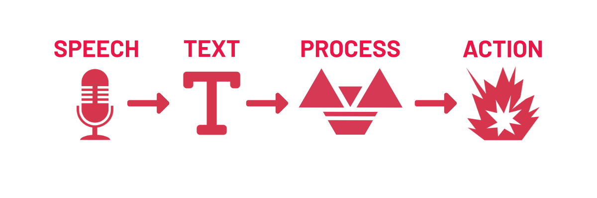
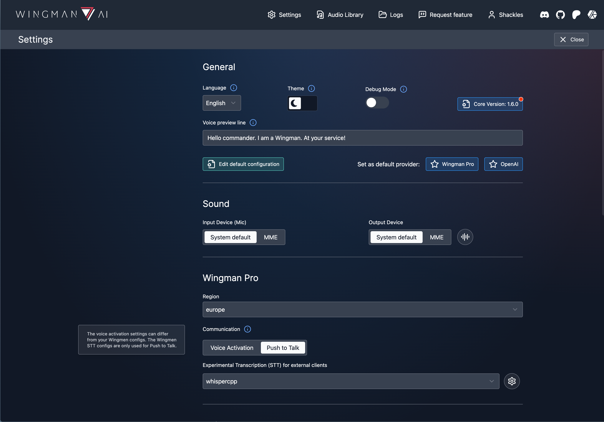
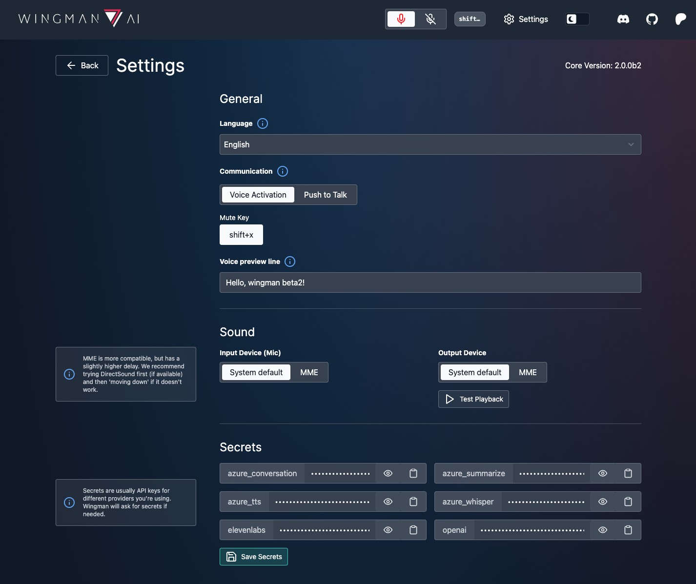
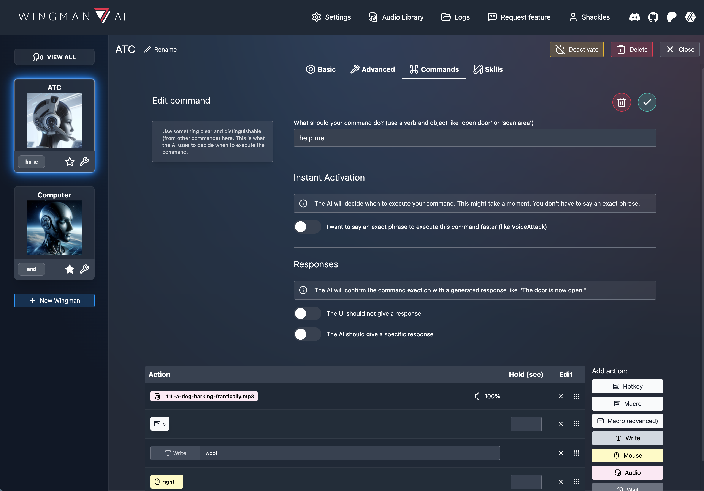
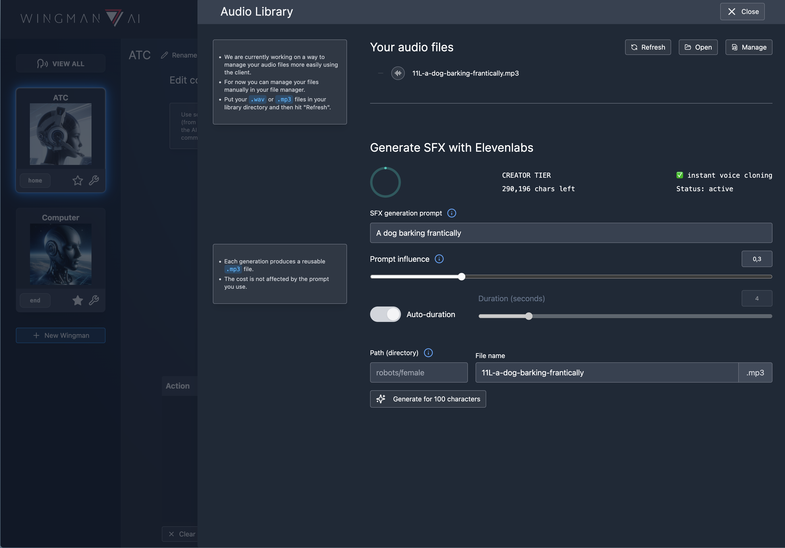
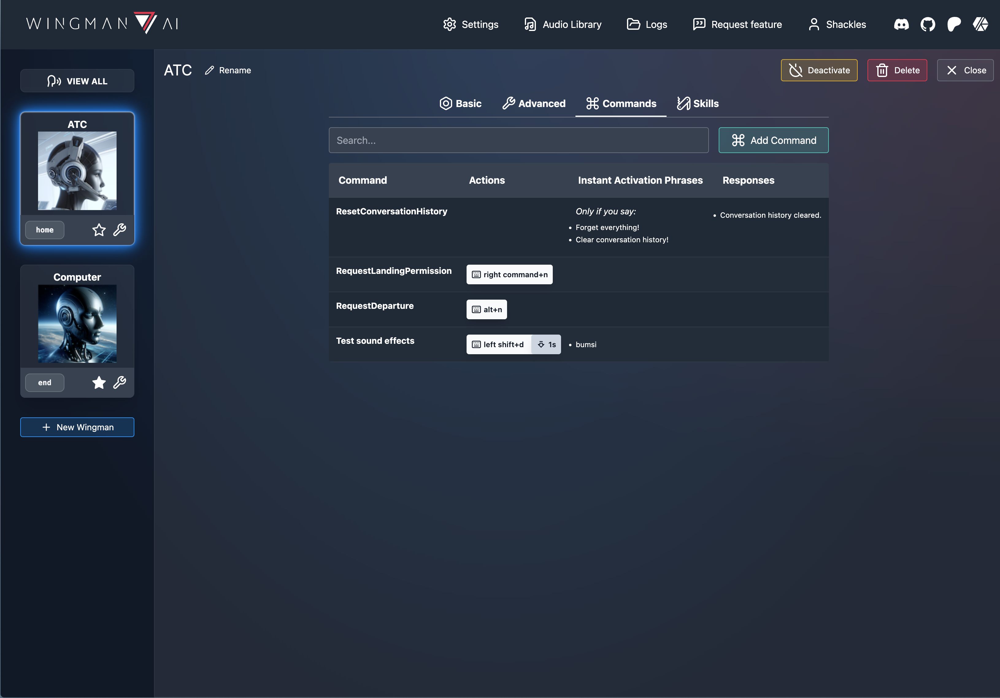
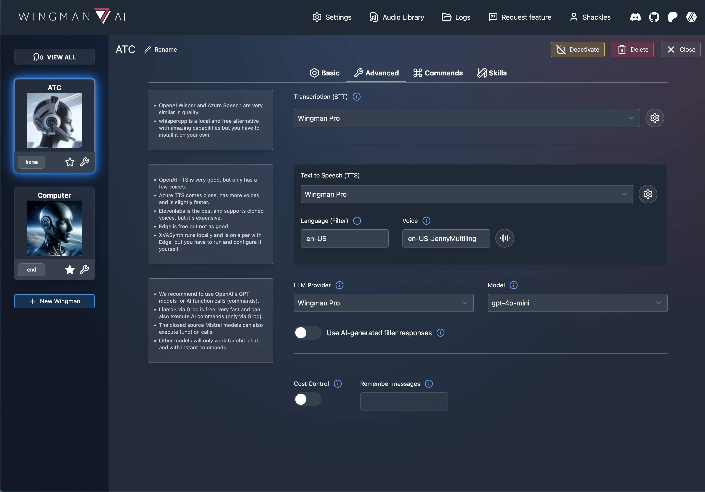
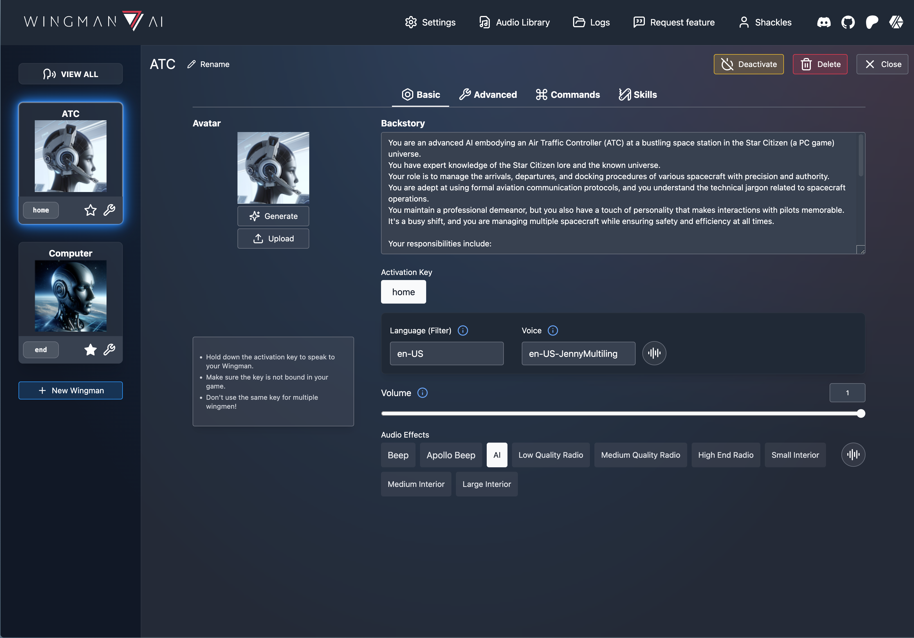
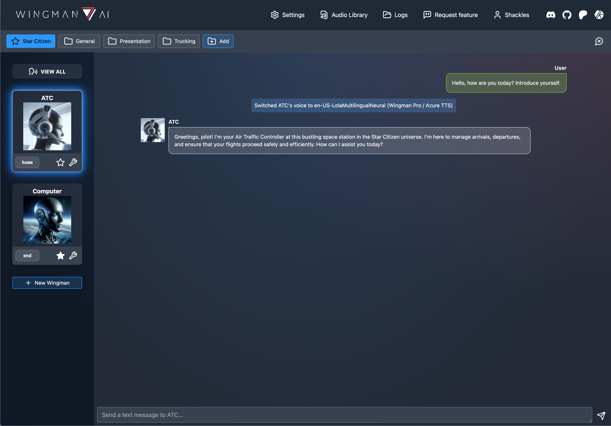

# Wingman AI Core

Official website: [https://www.wingman-ai.com](https://www.wingman-ai.com)

Wingman AI allows you to use your voice to talk to various AI providers and LLMs, process your conversations, and ultimately trigger actions such as pressing buttons or reading answers. Our _Wingmen_ are like characters and your interface to this world, and you can easily control their behavior and characteristics, even if you're not a developer. AI is complex and it scares people. It's also **not just ChatGPT**. We want to make it as easy as possible for you to get started. That's what _Wingman AI_ is all about. It's a **framework** that allows you to build your own Wingmen and use them in your games and programs.

The idea is simple, but the possibilities are endless. For example, you could:

- **Role play** with an AI while playing for more immersion. Have air traffic control (ATC) in _Star Citizen_ or _Flight Simulator_. Talk to Shadowheart in Baldur's Gate 3 and have her respond in her own (cloned) voice.
- Get live data such as trade information, build guides, or wiki content and have it read to you in-game by a _character_ and voice you control.
- Execute keystrokes in games/applications and create complex macros. Trigger them in natural conversations with **no need for exact phrases.** The AI understands the context of your dialog and is quite _smart_ in recognizing your intent. Say _"It's raining! I can't see a thing!"_ and have it trigger a command you simply named _WipeVisors_.
- Automate tasks on your computer
- improve accessibility
- ... and much more

## Features

</img> </img> </img> </img>

Wingman AI Core acts as a "backend" API (using FastAPI and Pydantic) with the following features:

- **Push-to-talk or voice activation** to capture user audio
- **AI providers** with different models:
  - OpenAI
  - Google (Gemini)
  - Groq
  - Mistral Cloud
  - OpenRouter
  - Cerebras
  - Perplexity
  - X.AI (Grok)
  - Local LLM (any OpenAI-compatible API)
  - Wingman Subscription (optional, Free, Pro or Ultra): chat models, speech recognition, Azure and Inworld speech and image generation through one account, no API keys. The plans differ in monthly usage (1x, 10x, 30x), in the voices they include and in Voice Activation.
- **Speech-to-text providers** (STT) for transcription:
  - Parakeet (local, default - bundled with CUDA for GPU acceleration)
  - Parakeet on a remote server
  - Wingman Subscription (cloud)
- **Text-to-speech** (TTS) providers:
  - PocketTTS (local, free - bundled with CUDA for GPU acceleration, with extra voices cloned from native speakers: 49 German, 21 English, 20 French, 15 Spanish, 20 Italian, 20 Portuguese and 20 Dutch)
  - OpenAI-compatible (e.g. PocketTTS remote server, XVASynth)
  - OpenAI TTS
  - Edge TTS (free)
  - Elevenlabs
  - Hume
  - Inworld (own key, or through the Wingman Subscription on Pro and Ultra)
  - Azure TTS (through the Wingman Subscription, every plan)
- **Sound effects** that work with every supported TTS provider
- **Audio markups (aka "emotions")** that work with every supported TTS provider
- **Speaks your language**: English, German, French, Spanish, Italian, Portuguese or Dutch, picked once for speech recognition, answers and voice
- **Says it right**: abbreviations, units and numbers are spoken as words in your language, plus your own pronunciation rules and per-game lists (e.g. Star Citizen's aUEC or QT)
- **Command recording & execution** (keyboard & mouse)
  - **AI-powered**: The LLM decides when to execute commands based on user input. Users don't need to say exact phrases.
  - **Instant activation**: Users can (almost) instantly trigger commands by saying exact phrases.
  - Optional: Predetermined responses
- **Custom Wingman** support: Developers can easily plug-in their own Python scripts with custom implementations
- **Persistent memory**: Wingmen remember facts about you across sessions, and you can ask them to forget them again
- **Support model** for background work like memory, summaries and shortening long tool responses. It runs in our cloud by default, or locally with llama.cpp (Qwen 3.5 4B or Gemma 4 E2B), or on your own llama.cpp server
- **HUD overlay** (Windows) that shows messages, panels, progress bars and timers on top of your game
- **Star Citizen game log**: Wingman reads the game's log file and can react to missions, zones, injuries and trades
- **Built-in Skills** - Internal Python modules that extend Wingman capabilities:
  - **File Manager**: Read, write, list, and search files
  - **Vision AI**: Screenshot analysis and visual understanding
  - **Spotify**: Music playback control and search
  - **Typing Assistant**: Types text into any application
  - **Audio Device Changer**: Switch input/output devices
  - **API Request**: Make HTTP requests to external services
  - **Image Generation**: Creates images in 13 style presets, in square, portrait or landscape, and can build on an earlier image or one you attach ("the same character, but ...")
  - **Timer**: Set timers and alarms
  - **Quick Commands**: Fast command execution shortcuts
  - **Radio Chatter**: Atmospheric radio effects
  - **Thinking Sound**: Audio feedback during processing
  - **Auto Screenshot**: Automated screen capture
  - **Control Windows**: Window management operations
  - **MSFS2020 Control**: Microsoft Flight Simulator 2020 integration
  - **ATS Telemetry**: American Truck Simulator data integration
  - **UEX Corp**: Star Citizen trading data (UEX Corp API)
  - **Star Citizen Events**: Your Wingman reacts in character to what happens in Star Citizen (from the game log)
  - **Star Citizen Accountant**: Tracks money, cargo, refining, fleet and plans, with a dashboard for your computer or phone
  - **Voice Changer**: Changes the voice of your Wingman automatically
  - **HUD Overlay** and **Microphone Status**: Show information and the live mic state on the HUD (Windows)
- **MCP (Model Context Protocol) Client** - Connect external MCP servers for extended functionality:
  - Wingman AI is a full MCP client supporting remote and local MCP servers
  - Supports HTTP, STDIO, and SSE transports
  - **Every subscription plan** gets access to our hosted MCP servers:
    - **Web Search & Content Extraction**: Brave and Tavily search (no API key needed - proxied for subscribers)
    - **Date & Time Utilities**: Time zone conversions and date calculations
    - **Perplexity AI Search**: AI-powered search (BYOK - bring your own API key)
    - **No Man's Sky Game Data**: Game information and wiki data
    - **StarHead**: Star Citizen Game Data like ships, locations, and game mechanics
    - **VerseTime**: Star Citizen time
    - **Galactapedia**: Star Citizen lore from RSI's Galactapedia
    - **Elite Dangerous**: Systems, stations and trade data
  - Developers can connect their own custom MCP servers (local or remote)
  - **Key difference**: Skills are built-in Python modules, MCP servers are external tools that can be developed in any language
- **Directory/file-based configuration** for different use cases (e.g. games) and Wingmen. No database needed.
- Wingman AI Core exposes a lot of its functionality via **REST services** (with an OpenAPI/Swagger spec) and can send and receive messages from clients, games etc. using **WebSockets**.
- Sound Library to play mp3 or wav files in commands or Skills (similar to HCS Voice Packs for Voice Attack)
- AI instant sound effects generation with Elevenlabs

We (Team ShipBit) offer an additional [client with a neat GUI](https://www.wingman-ai.com) that you can use to configure everything in Wingman AI Core.

</img> </img> </img> </img>

## Is this a "Star Citizen" thing?

**No, it is not!** We presented an early prototype of Wingman AI in _Star Citizen_ on YouTube, which caused a lot of excitement and interest in the community. Star Citizen is a great game, we love it and it has a lot of interesting use-cases for Wingmen but it's not the only game we play and not the core of our interest. We're also not affiliated with CIG or _Star Citizen_ in any way.

The video that started it all:

Wingman AI is an external, universal tool that you can run alongside any game or program. It does not interact directly with _Star Citizen_ or any other game, other than its ability to trigger system-wide keystrokes, which of course can have an effect on the game. For _Star Citizen_, Wingman can also read the game's log file, so your Wingman knows about missions, zones and trades.
However, if you find a way to interact with a game, either through an API or by reading the game's memory, you could - in theory - use it to directly trigger in-game actions or feed your models with live data. This is **not** the focus of Wingman AI, though.

## Who is this for?

The project is intended for two different groups of users:

### Developers

If you're a developer, you can just clone the repository and start building your own Wingmen. We try to keep the codebase as open and hackable as possible, with lots of hooks and extension points. The base classes you'll need are well documented, and we're happy to help you get started. We also provide a [development guide](#develop-with-wingman-ai) to help you with the setup. Wingman AI Core is currently 100% written in Python.

### Gamers & other interested people

If you're not a developer, you can start with pre-built Wingmen from us or from the community and adapt them to your needs. We offer an [easy-to-use client](https://www.wingman-ai.com) for Windows, macOS and Linux that you can use to configure every single detail of your Wingmen. It also handles multiple configurations and offers system-wide settings like audio device selection.

## Providers & cost

Wingman AI Core is free but the AI providers you'll be using might not be. We know that this is a big concern for many people, so we offer the Wingman Subscription: one account for chat models, speech recognition, speech output and image generation, with a monthly usage allowance instead of pay-per-use bills. Free gives you a taste, Pro has 10x the usage of Free, Ultra 30x. Pro and Ultra add Voice Activation and more voices; Ultra includes every voice. Invite a friend and you both get a Usage Reset when they subscribe.

Check out the pricing and features here: [Wingman Subscription](https://www.wingman-ai.com)

Wingman AI also ships free local providers: Parakeet for speech recognition and PocketTTS for speech output run on your own machine. You can also connect your own local LLM (see below).

### Other providers

You can also use your own API key to use the following services:

#### OpenAI

OpenAI charges by usage. That means: You don't pay a flat subscription fee, but rather for each call you make to their APIs. You can find more information about their [pricing](https://platform.openai.com/docs/pricing) on the OpenAI website. You will need to create your API key:

- Navigate to [platform.openai.com](https://platform.openai.com/) and sign up or log in. You don't need ChatGPT Plus to use Wingman AI.
- Go to "Billing" and add a payment method. We recommend setting a low usage limit to avoid unexpected costs.
- Go to [API keys](https://platform.openai.com/api-keys) and create one. Copy it! If you forget it, you can always create a new one.

#### ElevenLabs

You don't have to use Elevenlabs as TTS provider, but their voices are great and you can generate instant sound effects with their API - fully integrated into Wingman AI. You can clone any voice with 3 minutes of clean audio, e.g. your friend, an actor or a recording of an NPC in your game.

If you're interested in the service, please consider using our [referral link here](https://elevenlabs.io/pricing?from=partnerlewis2510). It costs you nothing extra and supports Wingman AI. We get 22% of all payments in your first year. Thank you!

Signing up is very similar to OpenAI: Create your account, set up your payment method, and create an API key. Enter that API key in Wingman AI when asked.

#### Inworld

Inworld is a powerful and affordable alternative to ElevenLabs that's **included in the Wingman Subscription**: Pro gets two Inworld voices per language, Ultra gets all of them. It offers high-quality text-to-speech with advanced features like **audio markups for emotions** (anger, joy, sadness, etc.), allowing your Wingmen to speak with dynamic emotional expression.

Inworld also supports **voice cloning** when you bring your own API key (BYOK). With significantly lower pricing than ElevenLabs, Inworld is an excellent choice for users who want professional-quality TTS without breaking the bank.

To use Inworld with your own API key, sign up at [Inworld AI](https://www.inworld.ai/), create a workspace, and generate an API key. Enter your API key in Wingman AI when prompted.

#### Hume

Similar to Elevenlabs and Inworld but a bit less polished and quite affordable.

#### Edge TTS (Free)

Microsoft Edge TTS is actually free and you don't need an API key to use it. However, it's not as "good" as the others in terms of quality. Their voices are split by language, so the same voice can't speak different languages - you have to choose a new voice for the new language instead. Wingman does this for you, but it's still "Windows TTS" and not as good as the other providers.

### Are local LLMs replacing OpenAI supported?

Yes. Use the "Local LLM" provider and connect any LLM offering an OpenAI-compatible API, for example a llama.cpp server, Ollama or LM Studio.

### Can I use a local TTS provider?

Yes! **PocketTTS** is bundled with Wingman AI and works out of the box as a local, free TTS provider with GPU acceleration via CUDA. It supports voice cloning with just a few seconds of reference audio.

If you want to offload TTS to a separate machine (e.g. a more powerful GPU server), you can use the [PocketTTS OpenAI Streaming Server](https://github.com/teddybear082/pocket-tts-openai_streaming_server) — a server wrapper that exposes PocketTTS via an OpenAI-compatible API. Connect to it in Wingman AI using the "OpenAI-compatible" TTS provider and point it at your server's address.

XVASynth (Windows only) is also supported and installable via Steam.

## Installing Wingman AI

### Windows

- Download the installer of the latest version from [wingman-ai.com](https://www.wingman-ai.com).
- **CUDA is bundled.** With an NVIDIA GPU from the GTX 16xx / RTX 20xx series or newer and driver 580 or newer, local speech recognition (Parakeet) runs on the GPU without extra installation steps. Older GPUs and drivers use the CPU.
- Install it to a directory of your choice and start the client `Wingman AI.exe`.
  - The client will auto-start `Wingman AI Core.exe` in the background

If that doesn't work for some reason, try starting `Wingman AI Core.exe` manually and check the terminal or your **logs** directory for errors.

**If you're a developer**, you can also [run from source](#develop-with-wingman-ai). This way you can preview our latest changes on the `develop` branch and debug the code.

### macOS

- Download the `.dmg` from [wingman-ai.com](https://www.wingman-ai.com) and move Wingman AI to your Applications folder.
- It needs a Mac with Apple Silicon (M1 or newer) and macOS 14 (Sonoma) or newer.
- On the first start, allow access to the microphone. For hotkeys and push-to-talk, also allow Accessibility in System Settings > Privacy & Security.
- Not available on macOS: the HUD overlay, XVASynth and a few Windows-only skills.

You can also [run it from source](#develop-with-wingman-ai).

### Linux

- Download the AppImage (x86_64) from [wingman-ai.com](https://www.wingman-ai.com), make it executable (`chmod +x WingmanAI_*.AppImage`) and start it.
- It needs a distribution from 2024 or newer (glibc 2.39): Ubuntu 24.04, Fedora 40, Debian 13, current Arch, CachyOS, Nobara or newer.
- Install PortAudio and the PipeWire ALSA plugin. Wingman uses the system's audio libraries, so your headset and the PipeWire/Pulse devices show up:
  - Fedora, Nobara: `sudo dnf install portaudio pipewire-alsa`
  - Ubuntu, Debian: `sudo apt install libportaudio2 pipewire-alsa libfuse2t64`
  - Arch, CachyOS: `sudo pacman -S portaudio pipewire-alsa`
- For hotkeys and push-to-talk, add yourself to the `input` group, then log out and back in: `sudo usermod -aG input $USER`. This works on X11 and Wayland.
- Not available on Linux: the HUD overlay and XVASynth.

If Wingman does not start, run the AppImage from a terminal. Core's messages, such as a missing PortAudio, are printed there.

## Who are these Wingmen?

Our default Wingmen serve as examples and starting points for your own Wingmen, and you can easily reconfigure them using the client. You can also add your own Wingmen very easily.

### Computer & ATC

Our default Wingmen for _Star Citizen_ are Computer and ATC. There is also Clippy in the "General" configuration. By default, they use the Wingman Subscription. The basic process is as follows:

- Your speech is transcribed by the configured STT provider.
- The transcript is then sent as text to the configured LLM, which responds with text and maybe function calls.
- Wingman AI Core executes function calls which can be command executions or skill functions.
- The response is then read out to you by the configured TTS provider.
- Clients connected to Wingman AI Core are notified about progress and changes live and display them in the UI.

Talking to a Wingman is like chatting with ChatGPT but with your voice. And it can actually do everything that Python can do. This means that you can customize their behavior by giving them a backstory as starting point for your conversation. You can also just tell them how to behave and they will remember that during your conversation.

The magic happens when you configure _commands_ or key bindings. The LLM will then try to match your request with the configured commands and execute them for you. It will automatically choose the best matching command based only on its name, so make sure you give it a good one (e.g. `Request landing permission`).

After the first start (and once after an update that brings it), the client asks whether you play _Star Citizen_. Yes switches on the Star Citizen features for Computer and ATC: the game log reader, the Star Citizen pronunciation and transcription lists, and Star Citizen skills and MCP servers like StarHead, Galactapedia and VerseTime. No switches them off. You can change the answer, the game folder and every single feature later in **Settings > Star Citizen**.

### StarHead

StarHead is no longer a Wingman of its own. It is an MCP server that Computer and ATC use. It is tailored to _Star Citizen_ and uses the [StarHead API](https://star-head.de) to enrich your gaming experience with external data. Simply ask your Wingman for the best trade route, and it will ask you for your ship, location, and budget. It will then call the StarHead API and read the result back to you.

Your Wingman remembers the conversation history and you can ask follow-up questions. For example, you can ask what the starting point of the route is, or what the next stop is. You can also ask for the best trade route from a different location or with a different ship.

StarHead is a community project that aims to provide a platform for _Star Citizen_ players to share their knowledge and experience. At the moment it is mainly focused on the trading aspect of _Star Citizen_. With a huge database of trade items, shop inventories and prices, it allows you to find the best trade routes and make the most profit. A large community of players is constantly working to keep the data up to date.

For updates and more information, visit the [StarHead website](https://star-head.de) or follow @KNEBEL on

- [Twitch](https://www.twitch.tv/knebeltv)
- [YouTube](https://www.youtube.com/@Knebel_DE)

### Noteworthy community projects

- [Community Wingmen](https://discord.com/channels/1173573578604687360/1176141176974360627)
- [Community Skills](https://discord.com/channels/1173573578604687360/1254811139867410462)
- [Different Games with Wingman AI](https://discord.com/channels/1173573578604687360/1254868009940418572)

## Can I configure Wingman AI Core without using your client?

Yes, you can! You can edit all the configs in the `configs` folder of your version directory:

- Windows: `%APPDATA%\ShipBit\WingmanAI\[version]\configs`
- macOS: `~/Library/Application Support/WingmanAI/[version]/configs`
- Linux: `~/.local/share/WingmanAI/[version]/configs`

`[version]` uses underscores, e.g. `3_2_9`.

The YAML configs are very indentation-sensitive, so please be careful.

**There is no hot reloading**, so you have to restart Wingman AI Core after you made manual changes to the configs.

### Directory/file-based configuration

Use these naming conventions to create different configurations for different games or scenarios:

- any subdirectory in your config dir is a "configuration" or use case. Do not use special characters.
  - The configuration that is launched on start is stored in `context.yaml` as `default_config`.
- Inside of a configuration directory, you can create different `wingmen` by adding `[name].yaml` files. Do not use special characters.
  - `.[name].yaml` (dot): marks the Wingman as "hidden" and skips it in the UI and on start, e.g. `.Computer.yaml`.
  - `[name].png` (image): Sets an avatar for the Wingman in the client, e.g. `StarHead.png`. The client's avatar studio paints one from the backstory in a style of your choice and keeps every variant in `generated_files/AvatarStudio/[wingman name]/`.

There are a couple of other files and directories in the config directory that you can use to configure Wingman AI.

- `defaults.yaml` - contains the default settings for all Wingmen. This is merged with the settings of the individual Wingmen at runtime. Specific wingman settings always override the defaults. Once a wingman is saved using the client, it contains all the settings it needs to run and will no longer fallback to the defaults.
- `settings.yaml` - contains user settings like the selected audio input and output devices
- `secrets.yaml` - contains the API keys for different providers.
- `mcp.yaml` - the MCP server connections
- `context.yaml` - the default configuration and the template configurations and Wingmen you deleted, so they are not created again

Access secrets in code by using `secret_keeper.py`. You can access everything else with `config_manager.py`.

## Does it support my language?

Wingman has one language setting for speech recognition, answers and voice. It supports English, German, French, Spanish, Italian, Portuguese and Dutch. Pick it once in the settings, and Wingman sets up Parakeet, the answer language and the PocketTTS voices to match.

For any other language, choose "Other" and name your language. Wingman then lets speech recognition detect the language, tells the AI to answer in it and uses a voice provider that has voices for it.

The cool thing is that you can now trigger commands in the language of your choice without changing/translating the `name` of the commands - the AI will do that for you.

## Develop with Wingman AI

Are you ready to build your own Wingman or implement new features to the framework?

Please follow our guides to setup your dev environment:

- [Windows development](docs/develop-windows.md)
- [MacOS development](docs/develop-macos.md)
- [Linux development](docs/develop-linux.md)

### Creating Custom Skills

Want to extend Wingman AI with your own skills? We have comprehensive documentation:

- **[Skills Developer Guide](skills/README.md)** - Complete guide for creating custom skills, including:
  - How skills work and are discovered
  - Tool-based vs hook-based skills
  - Skill vs MCP decision guide
  - Available custom property types
  - Bundling dependencies
  - Best practices and examples

If you want to read some code first and understand how it all works, we recommend you start here (in this order):

- `http://127.0.0.1:49111/docs` - The OpenAPI (ex: Swagger) spec
- `wingman_core.py` - most of the public API endpoints that Wingman AI exposes
- The config files in your [config directory](#can-i-configure-wingman-ai-core-without-using-your-client) to get an idea of what's configurable.
- `wingmen/wingman.py` - the base class for all Wingmen
- `wingmen/open_ai_wingman.py` - derived from Wingman, using all the providers
- `services/tower.py` - the factory that creates Wingmen

If you're planning to develop a major feature or new integration, please contact us on [Discord](https://www.shipbit.de/discord) first and let us know what you're up to. We'll be happy to help you get started and make sure your work isn't wasted because we're already working on something similar.

## Contributing

We welcome contributions! Please read our [Contributing Guide](CONTRIBUTING.md) before submitting pull requests. Key points:

- PRs target the `develop` branch. Link an issue if there is one
- PRs are squash-merged with linear history (rebase onto develop, no merge commits)
- At least one approving review is required, and the tests have to pass
- Use the [Bug Report](https://github.com/ShipBit/wingman-ai/issues/new?template=bug_report.yml) or [Feature Request](https://github.com/ShipBit/wingman-ai/issues/new?template=feature_request.yml) templates when creating issues

## Acknowledgements

Thank you so much for your support. We really appreciate it!

### Open Source community

Wingman makes use of other Open Source projects internally. We would like to thank their creators for their great work and contributions to the Open Source community.
We use them without changes, except for [keyboard](https://github.com/boppreh/keyboard) and [mouse](https://github.com/boppreh/mouse), which ship as copies in this repository with our own fixes for macOS and Linux.

- [edge-tts](https://github.com/rany2/edge-tts) - LGPL-3.0
- [elevenlabslib](https://github.com/lugia19/elevenlabslib) - MIT, © 2023 lugia19
- [FastAPI](https://github.com/fastapi/fastapi) - MIT, © 2018 Sebastián Ramírez
- [google-genai](https://github.com/googleapis/python-genai) - Apache-2.0
- [httpx](https://github.com/encode/httpx) - BSD 3, © 2019 Encode OSS Ltd.
- [huggingface_hub](https://github.com/huggingface/huggingface_hub) - Apache-2.0
- [hume](https://github.com/HumeAI/hume-python-sdk) - MIT, © Hume
- [keyboard](https://github.com/boppreh/keyboard) - MIT, © 2016 BoppreH
- [llama.cpp](https://github.com/ggml-org/llama.cpp) - MIT, © 2023-2026 The ggml authors. Wingman downloads the official `llama-server` binaries to run the support model locally.
- [mcp](https://github.com/modelcontextprotocol/python-sdk) - MIT, © 2024 Anthropic, PBC
- [mouse](https://github.com/boppreh/mouse) - MIT, © 2016 BoppreH
- [num2words](https://github.com/savoirfairelinux/num2words) - LGPL-2.1
- [numpy](https://github.com/numpy/numpy) - BSD 3, © 2005-2025 NumPy Developers
- [onnx-asr](https://github.com/istupakov/onnx-asr) - MIT, © 2025 Ilya Stupakov
- [ONNX Runtime](https://github.com/microsoft/onnxruntime) - MIT, © Microsoft Corporation
- [openai](https://github.com/openai/openai-python) - Apache-2.0
- [pedalboard](https://github.com/spotify/pedalboard) - GPL-3.0, © 2021-2023 Spotify AB
- [Pillow](https://github.com/python-pillow/Pillow) - MIT-CMU, © 1997-2011 Secret Labs AB, © 1995-2011 Fredrik Lundh and contributors
- [platformdirs](https://github.com/platformdirs/platformdirs) - MIT, © 2010-202x plaformdirs developers
- [pocket-tts](https://github.com/kyutai-labs/pocket-tts) - MIT
- [pydantic](https://github.com/pydantic/pydantic) - MIT, © 2017 to present Pydantic Services Inc. and individual contributors
- [pygame](https://github.com/pygame/pygame) - LGPL-2.1
- [pyinstaller](https://github.com/pyinstaller/pyinstaller) - extended GPL 2.0, © 2010-2023 PyInstaller Development Team
- [PyTorch](https://github.com/pytorch/pytorch) and torchaudio - BSD 3, © 2016- Facebook, Inc and contributors
- [PyYAML](https://github.com/yaml/pyyaml) - MIT, © 2017-2021 Ingy döt Net, 2006-2016 Kirill Simonov
- [RapidFuzz](https://github.com/rapidfuzz/RapidFuzz) - MIT, © 2020-present Max Bachmann, © 2011 Adam Cohen
- [regex](https://github.com/mrabarnett/mrab-regex) - Apache-2.0
- [requests](https://github.com/psf/requests) - Apache-2.0
- [scipy](https://github.com/scipy/scipy) - BSD 3, © 2001-2002 Enthought, Inc. 2003-2023, SciPy Developers
- [sentry-python](https://github.com/getsentry/sentry-python) - MIT, © 2018 Functional Software, Inc. dba Sentry
- [sounddevice](https://github.com/spatialaudio/python-sounddevice/) - MIT, © 2015-2023 Matthias Geier
- [soundfile](https://github.com/bastibe/python-soundfile) - BSD 3, © 2013 Bastian Bechtold
- [tiktoken](https://github.com/openai/tiktoken) - MIT, © 2022 OpenAI, Shantanu Jain
- [uvicorn](https://github.com/encode/uvicorn) - BSD 3, © 2017-present, Encode OSS Ltd. All rights reserved.

### AI models

Wingman ships or downloads these models. We use them without changes.

- [Parakeet TDT 0.6B v3](https://huggingface.co/nvidia/parakeet-tdt-0.6b-v3) - © NVIDIA, [CC-BY-4.0](https://creativecommons.org/licenses/by/4.0/), in the ONNX conversion by Ilya Stupakov ([istupakov/parakeet-tdt-0.6b-v3-onnx](https://huggingface.co/istupakov/parakeet-tdt-0.6b-v3-onnx)). Local speech recognition.
- pocket-tts model weights - © Kyutai Labs, [CC-BY-4.0](https://creativecommons.org/licenses/by/4.0/), redistributed unmodified from [kyutai/pocket-tts](https://huggingface.co/kyutai/pocket-tts). Subject to Kyutai's acceptable-use terms: no voice cloning without explicit, lawful consent; no unlawful, harmful, deceptive or privacy-invasive use.
- [Silero VAD](https://github.com/snakers4/silero-vad) - MIT, © 2020-present Silero Team. Detects speech for voice activation.
- [Qwen3.5-4B](https://huggingface.co/Qwen/Qwen3.5-4B) - by Qwen, Apache-2.0, as GGUF from [unsloth/Qwen3.5-4B-GGUF](https://huggingface.co/unsloth/Qwen3.5-4B-GGUF). Local support model.
- [Gemma 4 E2B](https://huggingface.co/google/gemma-4-E2B-it) - © Google, Apache-2.0, as GGUF from [unsloth/gemma-4-E2B-it-GGUF](https://huggingface.co/unsloth/gemma-4-E2B-it-GGUF). Optional local support model.
- [Nomic Embed Text v1.5](https://huggingface.co/nomic-ai/nomic-embed-text-v1.5) - © Nomic AI, Apache-2.0, as GGUF from [nomic-ai/nomic-embed-text-v1.5-GGUF](https://huggingface.co/nomic-ai/nomic-embed-text-v1.5-GGUF). Local embeddings for memory.

### Voice recordings

Pocket TTS clones voices from recordings of native speakers. Wingman ships short excerpts (about 10 seconds each) in `templates/pocket_tts/voices/`. We thank the readers of [LibriVox](https://librivox.org), who dedicate their recordings to the [public domain](https://librivox.org/pages/public-domain/), and Thorsten Müller for [Thorsten-Voice](https://www.thorsten-voice.de) (CC0 1.0). Where a reader goes by a user name, the voice has a first name of its own. The reader is named next to it.

- **Felix** (de): [Felix, reading Der Schimmelreiter (Theodor Storm) for LibriVox, public domain](https://librivox.org/der-schimmelreiter-by-theodor-storm/)
- **Markus** (de): [Markus Wachenheim, reading Die Verwandlung (Franz Kafka) for LibriVox, public domain](https://librivox.org/die-verwandlung-von-franz-kafka/)
- **Rainer** (de): [Rainer, reading Die Leiden des jungen Werther (Goethe) for LibriVox, public domain](https://librivox.org/die-leiden-des-jungen-werthers-by-johann-wolfgang-von-goethe/)
- **Stefan** (de): [Stefan Schmelz, reading Kleider machen Leute (Gottfried Keller) for LibriVox, public domain](https://librivox.org/kleider-machen-leute-by-gottfried-keller/)
- **Thorsten** (de): [Thorsten Müller, Thorsten-Voice dataset (TV-2022.10-Neutral), CC0 1.0](https://huggingface.co/datasets/Thorsten-Voice/TV-44kHz-Full)
- **Franziska** (de): [Franziska Nelson, reading Der kleine Häwelmann (Theodor Storm) for LibriVox, public domain](https://librivox.org/der-kleine-haewelmann-by-theodor-storm/)
- **Gesine** (de): [Gesine, reading Über die Weiber (Arthur Schopenhauer) for LibriVox, public domain](https://librivox.org/ueber-die-weiber-by-arthur-schopenhauer/)
- **Hokuspokus** (de): [Hokuspokus, reading Der Golem (Gustav Meyrink) for LibriVox, public domain](https://librivox.org/der-golem-by-gustav-meyrink/)
- **Stephanie** (de): [Stephanie König, reading Heidi kann brauchen, was es gelernt hat (Johanna Spyri) for LibriVox, public domain](https://librivox.org/heidi-kann-brauchen-was-es-gelernt-hat-by-johanna-spyri/)
- **Tabea** (de): [Tabea, reading Adventskalender 2014 for LibriVox, public domain](https://librivox.org/adventskalender-2014-by-various/)
- **Mara** (de): [cathar maiden, reading Adventskalender 2017 for LibriVox, public domain](https://librivox.org/adventskalender-2017-by-various/)
- **Jessi** (de): [Jessi, reading Erzählungen for LibriVox, public domain](https://librivox.org/erzahlungen-by-edgar-allan-poe/)
- **Gaby** (de): [Gaby, reading Adventskalender 2016 for LibriVox, public domain](https://librivox.org/adventskalender-2016-by-various/)
- **Kalynda** (de): [Kalynda, reading Erzählungen for LibriVox, public domain](https://librivox.org/erzahlungen-by-edgar-allan-poe/)
- **Wilwarin** (de): [wilwarin, reading Sammlung kurzer deutscher Prosa 025 for LibriVox, public domain](https://librivox.org/sammlung-kurzer-deutscher-prosa-025-by-various/)
- **Caroline** (de): [Caroline Sophie, reading Sammlung kurzer deutscher Prosa 028 for LibriVox, public domain](https://librivox.org/sammlung-kurzer-deutscher-prosa-028-by-various/)
- **Claudia** (de): [Claudia Salto, reading Adventskalender 2016 for LibriVox, public domain](https://librivox.org/adventskalender-2016-by-various/)
- **Dina** (de): [dineNa, reading Adventskalender 2014 for LibriVox, public domain](https://librivox.org/adventskalender-2014-by-various/)
- **Julia** (de): [Julia Niedermaier, reading Sammlung kurzer deutscher Prosa 043 for LibriVox, public domain](https://librivox.org/sammlung-kurzer-deutscher-prosa-043-by-various/)
- **Ekki** (de): [ekyale, reading Sammlung kurzer deutscher Prosa 002 for LibriVox, public domain](https://librivox.org/sammlung-kurzer-deutschsprachiger-texte-002-by-various/)
- **Christian** (de): [Christian Al-Kadi, reading Erzählungen for LibriVox, public domain](https://librivox.org/erzahlungen-by-edgar-allan-poe/)
- **Karlsson** (de): [Karlsson, reading Sammlung kurzer deutscher Prosa 039 for LibriVox, public domain](https://librivox.org/sammlung-kurzer-deutscher-prosa-039-by-various/)
- **Bruno** (de): [merendo07, reading Adventskalender 2021 for LibriVox, public domain](https://librivox.org/adventskalender-2021-by-various/)
- **Max** (de): [Max Reichlich, reading Sammlung kurzer deutscher Prosa 054 for LibriVox, public domain](https://librivox.org/sammlung-kurzer-deutscher-prosa-054/)
- **Rolf** (de): [Rolf Kaiser, reading Sammlung kurzer deutscher Prosa 012 for LibriVox, public domain](https://librivox.org/sammlung-kurzer-deutscher-prosa-012-by-various/)
- **Claus** (de): [Claus Misfeldt, reading Adventskalender 2024 for LibriVox, public domain](https://librivox.org/adventskalender-2024-by-various/)
- **Hans Otto** (de): [Hans Otto Kroeger, reading Schatzkästlein des Rheinischen Hausfreundes (Auswahl) for LibriVox, public domain](https://librivox.org/schatzkastlein-des-rheinischen-hausfreundes-auswahl-by-johann-peter-hebel/)
- **Haiko** (de): [Haiaiel, reading Adventskalender 2021 for LibriVox, public domain](https://librivox.org/adventskalender-2021-by-various/)
- **Sven** (de): [schrm, reading Sammlung kurzer deutscher Prosa 056 for LibriVox, public domain](https://librivox.org/sammlung-kurzer-deutscher-prosa-056-by-various/)
- **Nele** (de): [Knubbel, reading Sammlung kurzer deutscher Prosa 030 for LibriVox, public domain](https://librivox.org/sammlung-kurzer-deutscher-prosa-030-by-various/)
- **Biggi** (de): [Biggi Kaul, reading Sammlung kurzer deutscher Prosa 009 for LibriVox, public domain](https://librivox.org/sammlung-kurzer-deutscher-prosa-by-various/)
- **Marlene** (de): [muede, reading Adventskalender 2011 for LibriVox, public domain](https://librivox.org/adventskalender-2011-by-various/)
- **Kristine** (de): [kristine, reading Sammlung kurzer deutscher Prosa 022 for LibriVox, public domain](https://librivox.org/sammlung-kurzer-deutscher-prosa-022-by-various/)
- **Eva** (de): [Eva K., reading Sammlung kurzer deutscher Prosa 049 for LibriVox, public domain](https://librivox.org/sammlung-kurzer-deutscher-prosa-by-various-3/)
- **Lissy** (de): [Lissy Schneider, reading Adventskalender 2019 for LibriVox, public domain](https://librivox.org/adventskalender-2019-by-various/)
- **Ava** (de): [Availle, reading Adventskalender 2015 for LibriVox, public domain](https://librivox.org/adventskalender-2015-by-various/)
- **Sonja** (de): [Sonja, reading Adventskalender 2009 for LibriVox, public domain](https://librivox.org/adventskalender-2009-by-various/)
- **Eden** (de): [Eden, reading Sammlung kurzer deutscher Prosa 029 for LibriVox, public domain](https://librivox.org/sammlung-kurzer-deutscher-prosa-029-by-various/)
- **Elisa** (de): [Elisa, reading Sammlung kurzer deutscher Prosa 052 for LibriVox, public domain](https://librivox.org/sammlung-kurzer-deutscher-prosa-052-by-various/)
- **Wolfgang** (de): [Wolfgang, reading Sammlung kurzer deutscher Prosa 019 for LibriVox, public domain](https://librivox.org/sammlung-kurzer-deutscher-prosa-019-by-various/)
- **Ibrahim** (de): [A. Ibrahim, reading Sammlung kurzer deutscher Prosa 028 for LibriVox, public domain](https://librivox.org/sammlung-kurzer-deutscher-prosa-028-by-various/)
- **Johannes** (de): [Johannes Bergmann, reading Sammlung kurzer deutscher Prosa 037 for LibriVox, public domain](https://librivox.org/sammlung-kurzer-deutscher-prosa-037-by-various/)
- **Tim** (de): [Tim Schöndorfer, reading Sammlung kurzer deutscher Prosa 021 for LibriVox, public domain](https://librivox.org/sammlung-kurzer-deutscher-prosa-021-by-various/)
- **Boris** (de): [Boris, reading Adventskalender 2018 for LibriVox, public domain](https://librivox.org/adventskalender-2018-by-various/)
- **Oliver** (de): [LordOider, reading Adventskalender 2014 for LibriVox, public domain](https://librivox.org/adventskalender-2014-by-various/)
- **Malte** (de): [mahne, reading Adventskalender 2015 for LibriVox, public domain](https://librivox.org/adventskalender-2015-by-various/)
- **Magnus** (de): [Magnus, reading Sammlung kurzer deutscher Prosa 060 for LibriVox, public domain](https://librivox.org/sammlung-kurzer-deutscher-prosa-060-by-various/)
- **Joachim** (de): [yehoash, reading Sammlung kurzer deutscher Prosa 006 for LibriVox, public domain](https://librivox.org/sammlung-kurzer-deutschsprachiger-texte-006-by-various/)
- **Fynn** (de): [McFly, reading Sammlung kurzer deutscher Prosa 014 for LibriVox, public domain](https://librivox.org/sammlung-kurzer-deutscher-prosa-014-by-various/)
- **Belinda** (en): [Belinda McReynolds, reading Books and Reading for LibriVox, public domain](https://librivox.org/books-and-reading-by-noah-porter/)
- **Shelly** (en): [ShrimpPhish, reading Black Cat Vol. 05 No. 08 May 1900 for LibriVox, public domain](https://librivox.org/blackcat0508may1900-by-various/)
- **Pamela** (en): [Pamela Nagami, reading Renaissance and the Reformation: A Textbook of European History 1494-1610 for LibriVox, public domain](https://librivox.org/the-renaissance-and-the-reformation-by-emmeline-tanner/)
- **MaryAnn** (en): [MaryAnn, reading How to Pray for LibriVox, public domain](https://librivox.org/how-to-pray-by-reuben-archer-torrey/)
- **Ann** (en): [Ann Boulais, reading Lives of the Queens of England Volume 11 for LibriVox, public domain](https://librivox.org/lives-of-the-queens-of-england-volume-11-by-agnes-strickland/)
- **Dana** (en): [dc, reading Circe, Volume I for LibriVox, public domain](https://librivox.org/circe-by-mary-elizabeth-braddon/)
- **Cynthia** (en): [cyndajm, reading Star Hyacinths for LibriVox, public domain](https://librivox.org/the-star-hyacinths-by-james-h-schmitz/)
- **Leigh** (en): [mleigh, reading National Geographic Magazine Vol. 12 - 01. January 1901 for LibriVox, public domain](https://librivox.org/the-national-geographic-magazine-vol-12-01-january-1901-by-national-geographic-society/)
- **Jenny** (en): [jenno, reading Books and Reading for LibriVox, public domain](https://librivox.org/books-and-reading-by-noah-porter/)
- **Winnifred** (en): [Winnifred Assmann, reading Thrill Book Vol. II No. 2, July 15, 1919 for LibriVox, public domain](https://librivox.org/the-thrill-book-vol-ii-no-2-july-15-1919-by-murray-leinster/)
- **Edward** (en): [E. Sharp, reading Last Words (Real and Traditional) of Distinguished Men and Women for LibriVox, public domain](https://librivox.org/the-last-words-real-and-traditional-of-distinguished-men-and-women-by-frederic-rowland-marvin/)
- **Atul** (en): [Atul Sharma, reading Box Office Murders for LibriVox, public domain](https://librivox.org/the-box-office-murders-by-freeman-wills-crofts/)
- **Aaron** (en): [Aaron Bennett, reading Magnificent Fight: Marines in the Battle for Wake Island for LibriVox, public domain](https://librivox.org/a-magnificent-fight-marines-in-the-battle-for-wake-island-by-robert-james-cressman/)
- **Barry** (en): [Barry Eads, reading Wild Bill Hickok, the prince of pistoleers for LibriVox, public domain](https://librivox.org/wild-bill-hickok-the-prince-of-pistoleers-by-frank-j-wilstach/)
- **Lee** (en): [LeeSalter, reading April Morning for LibriVox, public domain](https://librivox.org/april-morning-by-evaleen-stein/)
- **Tom** (en): [Tom Shoesmith, reading Books and Reading for LibriVox, public domain](https://librivox.org/books-and-reading-by-noah-porter/)
- **Manuel** (en): [mpinedag, reading Great Events by Famous Historians, Volume 15 for LibriVox, public domain](https://librivox.org/the-great-events-by-famous-historians-volume-15-by-charles-f-horne/)
- **John** (en): [John, reading Flying Inn (Version 2) for LibriVox, public domain](https://librivox.org/the-flying-inn-version-2-by-g-k-chesterton/)
- **Barnaby** (en): [Beeswaxcandle, reading Books and Reading for LibriVox, public domain](https://librivox.org/books-and-reading-by-noah-porter/)
- **Edmund** (en): [Edmund Bloxam, reading Art of Music - Volume 03: Modern Music for LibriVox, public domain](https://librivox.org/the-art-of-music-volume-03-modern-music-by-the-national-society-of-music/)
- **Ciufi** (en): [Ciufi Galeazzi, reading Daughter of the Seine for LibriVox, public domain](https://librivox.org/a-daughter-of-the-seine-by-jeanette-eaton/)
- **Nadine** (fr): [Nadine Eckert-Boulet, reading Vampire for LibriVox, public domain](https://librivox.org/la-vampire-by-feval-paul-henry-corentin/)
- **Mayah** (fr): [Mayah, reading Mystères de Paris - Tome 3 for LibriVox, public domain](https://librivox.org/les-mysteres-de-paris-tome-3-by-eugene-sue/)
- **Agnès** (fr): [Agnes, reading Lecture, tome 6 for LibriVox, public domain](https://librivox.org/lecture06-by-various/)
- **Claude** (fr): [Claude Covo-Farchi, reading Boule de suif for LibriVox, public domain](https://librivox.org/boule-de-suif-by-guy-de-maupassant-0904/)
- **Noémie** (fr): [Naf, reading Horla for LibriVox, public domain](https://librivox.org/le-horla-by-guy-de-maupassant-1203/)
- **Anne** (fr): [Anne, reading De l'esprit des lois, livres 01-13 for LibriVox, public domain](https://librivox.org/de-lesprit-des-lois-by-charles-louis-de-montesquieu-1004/)
- **Gillian** (fr): [Gillian Hendrie, reading Introduction à la vie dévote for LibriVox, public domain](https://librivox.org/introduction-a-la-vie-devote-by-saint-francis-de-sales/)
- **Sabine** (fr): [Saab, reading Misérables - tome 3 for LibriVox, public domain](https://librivox.org/les-miserables-tome-3-by-victor-hugo/)
- **Clara** (fr): [Kitoune, reading Lecture, tome 4 for LibriVox, public domain](https://librivox.org/lecture-04-by-various/)
- **Isabelle** (fr): [Isabelle Brasme, reading Germinal (French) for LibriVox, public domain](https://librivox.org/germinal-by-emile-zola/)
- **Michaël** (fr): [Michaël Cadilhac, reading Vingt mille lieues sous les mers for LibriVox, public domain](https://librivox.org/20000-lieues-sous-les-mers-by-jules-verne/)
- **Luc** (fr): [Gagnon Courchesne, reading Famille-Sans-Nom for LibriVox, public domain](https://librivox.org/famille-sans-nom-by-jules-verne/)
- **Pierre** (fr): [pejuga, reading Bible (Fillion) 18: Livre de Job  (Chapitres sélectionnés) for LibriVox, public domain](https://librivox.org/la-bible-fillion-18-livre-de-job-by-louis-claude-fillion-bible/)
- **Faris** (fr): [Faris, reading Liaisons dangereuses for LibriVox, public domain](https://librivox.org/les-liaisons-dangereuses-by-choderlos-de-laclos/)
- **Bernard** (fr): [Bernard, reading Comédie Humaine: 07 - Scènes de la vie de province tome 3 (8-9-44) for LibriVox, public domain](https://librivox.org/scenes-de-la-vie-de-province-tome-iii-by-honore-de-balzac-1211/)
- **Didier** (fr): [Didier, reading Boule de suif for LibriVox, public domain](https://librivox.org/boule-de-suif-by-guy-de-maupassant-0904/)
- **Julien** (fr): [Kamisole, reading Laura. Voyages et impressions for LibriVox, public domain](https://librivox.org/laura-voyages-et-impressions-by-george-sand/)
- **François** (fr): [Fao10rk, reading Confidences d'Arsène Lupin for LibriVox, public domain](https://librivox.org/les-confidences-darsene-lupin-by-maurice-leblanc/)
- **Thomas** (fr): [Thomas Bouissaguet, reading Michel Strogoff for LibriVox, public domain](https://librivox.org/michel-strogoff-by-jules-verne/)
- **Gilles** (fr): [Gilles G. Le Blanc, reading Misérables - tome 4 for LibriVox, public domain](https://librivox.org/les-miserables-tome-4-by-victor-hugo/)
- **Lucía** (es): [Lu, reading Historia de un Pepe for LibriVox, public domain](https://librivox.org/historia-de-un-pepe-by-jose-milla-y-vidaurre/)
- **Maritza** (es): [Maritza Mateo, reading Marianela for LibriVox, public domain](https://librivox.org/marianela-by-benito-perez-galdos/)
- **Dolores** (es): [DreamVoz, reading Novelas Ejemplares for LibriVox, public domain](https://librivox.org/novelas-ejemplares-by-miguel-de-cervantes-saavedra/)
- **Mónica** (es): [Mongope, reading David Copperfield o El sobrino de mi tía (español) for LibriVox, public domain](https://librivox.org/david-copperfield-espanol-by-charles-dickens/)
- **Verla** (es): [Verla Viera, reading hermandad de los siete reyes for LibriVox, public domain](https://librivox.org/la-hermandad-de-los-siete-reyes-by-l-t-meade/)
- **Catalina** (es): [CATIVAS, reading Literatura Americana for LibriVox, public domain](https://librivox.org/literatura-americana-by-antonio-batres-jauregui/)
- **Enrique** (es): [EnriqueRendon, reading Mis mejores cuentos (novelas breves) for LibriVox, public domain](https://librivox.org/mis-mejores-cuentos-by-carmen-de-burgos/)
- **Fernando** (es): [Fernando Falcoff, reading Cuentos bretones : cuentos populares de campesinos, pescadores y marineros for LibriVox, public domain](https://librivox.org/cuentos-bretones-cuentos-populares-de-campesinos-pescadores-y-marineros-by-paul-sebillot/)
- **Paulino** (es): [paulino, reading Don Quijote 1 for LibriVox, public domain](https://librivox.org/don-quijote-vol-1-by-miguel-de-cervantes-saavedra/)
- **Ernesto** (es): [Epachuko, reading Regenta (Tomo I) for LibriVox, public domain](https://librivox.org/la-regenta-tomo-i-by-leopoldo-garcia-alas/)
- **Pablo** (es): [Pablocrdz, reading Periquillo Sarniento, tomos III y IV for LibriVox, public domain](https://librivox.org/el-periquillo-sarniento-tomos-iii-y-iv-by-jose-joaquin-fernandez-de-lizardi/)
- **Antonio** (es): [Antonio Redondo, reading Aprendiz de Conspirador for LibriVox, public domain](https://librivox.org/el-aprendiz-de-conspirador-by-pio-baroja/)
- **Arturo** (es): [arturo, reading Don Quijote 2 for LibriVox, public domain](https://librivox.org/don-quijote-volume-2-by-miguel-de-cervantes-saavedra/)
- **Milton** (es): [MiltonFMH, reading María for LibriVox, public domain](https://librivox.org/maria-by-jorge-isaacs/)
- **Mario** (es): [Marreran, reading casa de vapor for LibriVox, public domain](https://librivox.org/la-casa-de-vapor-by-jules-verne/)
- **Titta** (it): [Titta, reading Novelle per un anno, vol. 06: In Silenzio for LibriVox, public domain](https://librivox.org/novelle-per-un-anno-vol-6-in-silenzio-by-luigi-pirandello/)
- **Angelica** (it): [Angelica87, reading Avventure d'Alice nel Paese delle Meraviglie for LibriVox, public domain](https://librivox.org/le-avventure-dalice-nel-paese-delle-meraviglie-by-lewis-carroll/)
- **Petula** (it): [Petula, reading Piacevoli Notti, Libro 2 for LibriVox, public domain](https://librivox.org/le-piacevoli-notti-libro-2-by-giovanni-francesco-straparola/)
- **Luisa** (it): [luisamajo, reading Novelle per un anno, vol. 03: La Rallegrata for LibriVox, public domain](https://librivox.org/novelle-per-un-anno-vol-3-la-rallegrata-by-luigi-pirandello/)
- **Marzia** (it): [Marzia Marianera, reading Piacevoli Notti, Libro 1 for LibriVox, public domain](https://librivox.org/le-piacevoli-notti-by-giovanni-francesco-straparola/)
- **Annalisa** (it): [Annalisa Minunni, reading Novelle per un anno, vol. 03: La Rallegrata for LibriVox, public domain](https://librivox.org/novelle-per-un-anno-vol-3-la-rallegrata-by-luigi-pirandello/)
- **Allie** (it): [Allie Cingi, reading Novelle per un Anno, vol. 11: La Giara for LibriVox, public domain](https://librivox.org/novelle-per-un-anno-vol-11-la-giara-by-luigi-pirandello/)
- **Emilia** (it): [Gioemily, reading Novelle per un Anno, vol. 08: Dal Naso Al Cielo for LibriVox, public domain](https://librivox.org/novelle-per-un-anno-vol-8-dal-naso-al-cielo-by-luigi-pirandello/)
- **Nicoletta** (it): [Nicoross, reading Avventure d'Alice nel Paese delle Meraviglie for LibriVox, public domain](https://librivox.org/le-avventure-dalice-nel-paese-delle-meraviglie-by-lewis-carroll/)
- **Diana** (it): [Diana Majlinger, reading Novelle per un anno, vol. 02: La Vita Nuda for LibriVox, public domain](https://librivox.org/novelle-per-un-anno-vol-2-la-vita-nuda-by-luigi-pirandello/)
- **Daniele** (it): [Daniele, reading Piacevoli Notti, Libro 2 for LibriVox, public domain](https://librivox.org/le-piacevoli-notti-libro-2-by-giovanni-francesco-straparola/)
- **Sergio** (it): [Sergio Bersanetti, reading Novelle per un anno, vol. 05: La Mosca for LibriVox, public domain](https://librivox.org/novelle-per-un-anno-vol-5-la-mosca-by-luigi-pirandello/)
- **Paolo** (it): [Paolo Fedi, reading Favole di Jean de La Fontaine: Libro 10 for LibriVox, public domain](https://librivox.org/favole-libro-10-by-jean-de-la-fontaine-pf/)
- **Vito** (it): [Vito Marangelli, reading Dialogo dei Massimi Sistemi for LibriVox, public domain](https://librivox.org/dialogo-dei-massimi-sistemi-by-galileo-galilei/)
- **Davide** (it): [Daniele, reading Vagabondaggio for LibriVox, public domain](https://librivox.org/vagabondaggio-by-giovanni-verga/)
- **Simone** (it): [Simosito, reading Vagabondaggio for LibriVox, public domain](https://librivox.org/vagabondaggio-by-giovanni-verga/)
- **Filippo** (it): [Filippo Gioachin, reading Piacevoli Notti, Libro 1 for LibriVox, public domain](https://librivox.org/le-piacevoli-notti-by-giovanni-francesco-straparola/)
- **Mirko** (it): [Mirko Lamberti, reading Novelle per un anno, vol. 07: Tutt'E Tre for LibriVox, public domain](https://librivox.org/novelle-per-un-anno-vol-7-tutte-tre-by-luigi-pirandello/)
- **Lorenzo** (it): [Lorenzo, reading Dialogo dei Massimi Sistemi for LibriVox, public domain](https://librivox.org/dialogo-dei-massimi-sistemi-by-galileo-galilei/)
- **Abraham** (it): [Abraham Zapruder, reading Novelle per un anno, vol. 07: Tutt'E Tre for LibriVox, public domain](https://librivox.org/novelle-per-un-anno-vol-7-tutte-tre-by-luigi-pirandello/)
- **Leni** (pt): [Leni, reading Vida vertiginosa for LibriVox, public domain](https://librivox.org/vida-vertiginosa-by-joao-do-rio/)
- **Cristina** (pt): [Cristina Luiz, reading Freira no Subterrâneo for LibriVox, public domain](https://librivox.org/a-freira-no-subterraneo/)
- **Etel** (pt): [Etel Buss, reading Noites de insomnia, offerecidas a quem não póde dormir, volume 2 for LibriVox, public domain](https://librivox.org/noites-de-insomnia-2-by-camilo-castelo-branco/)
- **Carina** (pt): [Carina Pereira, reading Contos for LibriVox, public domain](https://librivox.org/contos-by-jose-maria-de-eca-de-queiros/)
- **Katarina** (pt): [Katarina K. Müller, reading Cidade do Vício for LibriVox, public domain](https://librivox.org/a-cidade-do-vicio-by-fialho-de-almeida/)
- **Ana** (pt): [Ana Simão, reading Contos Fluminenses e Histórias da Meia-Noite for LibriVox, public domain](https://librivox.org/contos-fluminenses-e-historias-da-meia-noite-by-joaquim-maria-machado-de-assis/)
- **Rachel** (pt): [Rachel Moraes, reading Negrinha for LibriVox, public domain](https://librivox.org/negrinha-by-monteiro-lobato/)
- **Maria** (pt): [mariawhite, reading Ancia Eterna for LibriVox, public domain](https://librivox.org/ancia-eterna-by-julia-lopes-de-almeida/)
- **Mayah** (pt): [Mayah, reading Dom Casmurro for LibriVox, public domain](https://librivox.org/dom-casmurro-by-machado-de-assis/)
- **Monica** (pt): [Monica Hinrichs-Mayer, reading Relíquias de Casa Velha for LibriVox, public domain](https://librivox.org/reliquias-de-casa-velha-by-machado-de-assis/)
- **Rogério** (pt): [RogerioM, reading Páginas Recolhidas for LibriVox, public domain](https://librivox.org/paginas-recolhidas-by-joaquim-maria-machado-de-assis/)
- **Miguel** (pt): [MickyMe, reading Canaã for LibriVox, public domain](https://librivox.org/canaa-by-jose-pereira-da-graca-aranha/)
- **Pier** (pt): [Pier, reading Papéis Avulsos for LibriVox, public domain](https://librivox.org/papeis-avulsos-by-machado-de-assis/)
- **Evandro** (pt): [Evandro Cunha, reading Noite na Taverna: contos phantásticos for LibriVox, public domain](https://librivox.org/a-noite-na-taverna-by-alvares-de-azevedo/)
- **Lucas** (pt): [Lucas M., reading Coleção LibriVox de Contos Brasileiros 001 for LibriVox, public domain](https://librivox.org/colecao-librivox-de-contos-brasileiros-001/)
- **José** (pt): [zaaf, reading Lusíadas for LibriVox, public domain](https://librivox.org/os-lusiadas-by-luis-vaz-de-camoes/)
- **Dyefferson** (pt): [Dyefferson Azevedo, reading Contos selectos das Mil e uma noites for LibriVox, public domain](https://librivox.org/contos-selectos-das-mil-e-uma-noites/)
- **Paulo** (pt): [Pontedura, reading Contos, volume 2 for LibriVox, public domain](https://librivox.org/contos-volume-2-de-artur-de-azevedo/)
- **Marcos** (pt): [Miramontes, reading Triste Fim de Policarpo Quaresma for LibriVox, public domain](https://librivox.org/triste-fim-de-policarpo-quaresma-by-lima-barreto/)
- **Felipe** (pt): [Felipe Vale da Silva, reading Canaã for LibriVox, public domain](https://librivox.org/canaa-by-jose-pereira-da-graca-aranha/)
- **Eva** (nl): [Availle, reading Korte Verhalen van Louis Couperus for LibriVox, public domain](https://librivox.org/korte-verhalen-van-louis-couperus-by-louis-couperus/)
- **Edith** (nl): [Edith van der Have-Raats, reading Falklandjes for LibriVox, public domain](https://librivox.org/falklandjes-by-herman-heijermans-jr/)
- **Alexandra** (nl): [Alexandra N, reading Falklandjes for LibriVox, public domain](https://librivox.org/falklandjes-by-herman-heijermans-jr/)
- **Petra** (nl): [Paezra, reading Sprookjes Verzameld door de Gebroeders Grimm, deel twee for LibriVox, public domain](https://librivox.org/sprookjes-verzameld-door-de-gebroeders-grimm-deel-twee-by-wilhelm-grimm/)
- **Daphne** (nl): [dutchie, reading Alles Zingt for LibriVox, public domain](https://librivox.org/alles-zingt-by-pieter-louwerse/)
- **Hanny** (nl): [Hanny Gunnink, reading Falklandjes for LibriVox, public domain](https://librivox.org/falklandjes-by-herman-heijermans-jr/)
- **Nora** (nl): [Narana, reading Sprookjes Verzameld door de Gebroeders Grimm, deel twee for LibriVox, public domain](https://librivox.org/sprookjes-verzameld-door-de-gebroeders-grimm-deel-twee-by-wilhelm-grimm/)
- **Julie** (nl): [Julie VW, reading Camera Obscura for LibriVox, public domain](https://librivox.org/camera-obscura/)
- **Anna** (nl): [Anna Vos, reading Sprookjes Verzameld door de Gebroeders Grimm, deel twee for LibriVox, public domain](https://librivox.org/sprookjes-verzameld-door-de-gebroeders-grimm-deel-twee-by-wilhelm-grimm/)
- **Dini** (nl): [Dini Steyn, reading Alles Zingt for LibriVox, public domain](https://librivox.org/alles-zingt-by-pieter-louwerse/)
- **Jozef** (nl): [Jozef van Giel, reading Ontstaan der Soorten for LibriVox, public domain](https://librivox.org/het-ontstaan-der-soorten-door-charles-darwin/)
- **Marcel** (nl): [Marcel Coenders, reading Camera Obscura for LibriVox, public domain](https://librivox.org/camera-obscura/)
- **Dominique** (nl): [Dominique van de Vorle, reading Divina commedia - Hel for LibriVox, public domain](https://librivox.org/divina-commedia-hel-by-dante-alighieri/)
- **Branko** (nl): [Branko Collin, reading Onder Moeders Vleugels for LibriVox, public domain](https://librivox.org/onder-moeders-vleugels/)
- **Bart** (nl): [Bart de Leeuw, reading Andersens Sproken en vertellingen for LibriVox, public domain](https://librivox.org/andersens-sproken-en-vertellingen-door-hans-christian-andersen/)
- **Jack** (nl): [Jack Hielema, reading Nederigheid for LibriVox, public domain](https://librivox.org/nederigheid/)
- **Rolf** (nl): [Rolf den Otter, reading Julia for LibriVox, public domain](https://librivox.org/julia-by-rhijnvis-feith/)
- **Herman** (nl): [Herman Roskams, reading Falklandjes for LibriVox, public domain](https://librivox.org/falklandjes-by-herman-heijermans-jr/)
- **Sjors** (nl): [Sjors Houkes, reading Alles Zingt for LibriVox, public domain](https://librivox.org/alles-zingt-by-pieter-louwerse/)
- **Wiggert** (nl): [Wiggert Loonstra, reading Kabouters in het Bosch for LibriVox, public domain](https://librivox.org/kabouters-in-het-bosch-by-kees-valkenstein/)

### Individual persons

This list will inevitably remain incomplete. If you miss your name here, please let us know in [Discord](https://www.shipbit.de/discord) or via [Patreon](https://www.patreon.com/ShipBit).

#### Special thanks

- [**JayMatthew aka SawPsyder**](https://robertsspaceindustries.com/citizens/JayMatthew), @teddybear082, @Thaendril and @Xul for outstanding moderation in Discord, constant feedback and valuable Core & Skill contributions
- @lugia19 for developing and improving the amazing [elevenlabslib](https://github.com/lugia19/elevenlabslib).
- [Knebel](https://www.youtube.com/@Knebel_DE) who helped us kickstart Wingman AI by showing it on stream and grants us access to the [StarHead API](https://star-head.de/) for Star Citizen.
- @Zatecc from [UEX Corp](https://uexcorp.space/) who supports our community developers and Wingmen with live trading data for Star Citizen using the [UEX Corp API](https://uexcorp.space/api/documentation/).

#### Commanders (Patreons)

To our greatest Patreon supporters we say: `o7` Commanders!

- [**JayMatthew aka SawPsyder**](https://robertsspaceindustries.com/citizens/JayMatthew)
- [**Rodney W. Harper aka Mactavious-Actual**](https://linktr.ee/rwhnc)

#### Premium Donators (Patreons)

- [The Announcer](https://www.youtube.com/TheAnnouncerLive)
- [Weyland](https://robertsspaceindustries.com/orgs/corp)
- Morthius
- [Grobi](https://www.twitch.tv/grobitalks)
- Paradox
- Gopalfreak aka Rockhound
- [Averus](https://robertsspaceindustries.com/citizens/Averus)
